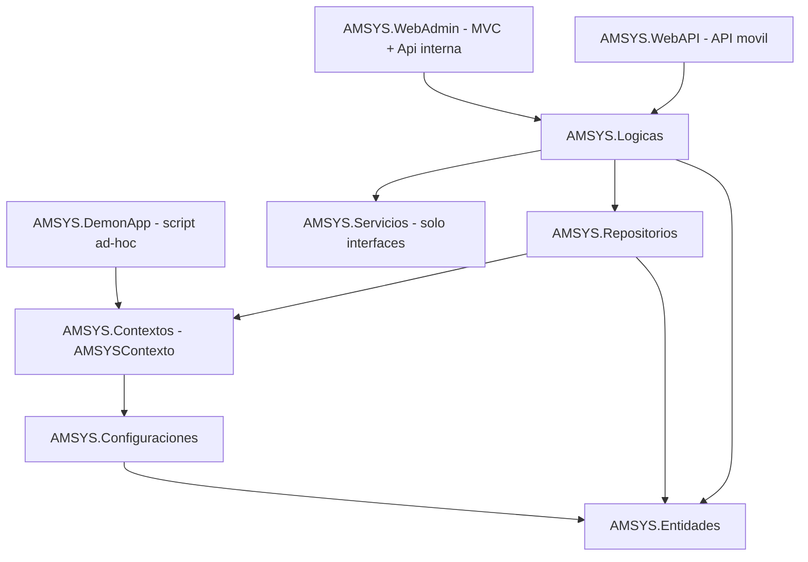
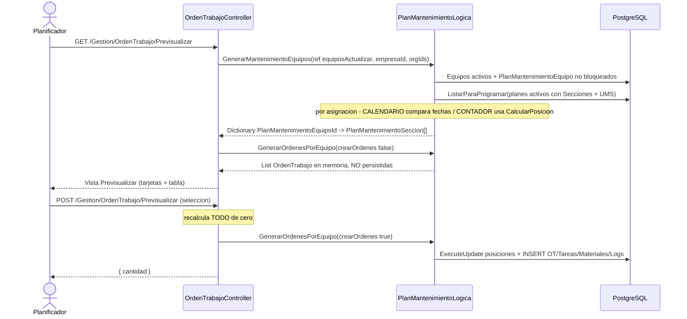

# Arquitectura Actual – Módulo de Mantenimiento (AMSYS)

> Este documento describe **cómo está implementado hoy**, no cómo debería estarlo.
> Las propuestas se marcan explícitamente como `RECOMENDACIÓN`.

---

## 1. Vista general de la solución

`AMSYS.sln` contiene 10 proyectos:

| Proyecto | Rol real | Depende de |
|----------|----------|-----------|
| `AMSYS.Entidades` | POCOs de dominio + **Filtros** (objetos de consulta) + Constantes (enums) + DTOs + lógica de dominio en `*.Adicional.cs` | — |
| `AMSYS.Configuraciones` | Mapeo EF Core (`EntityTypeBuilder<T>`), clases estáticas `XxxConfig.Configure(...)` | Entidades |
| `AMSYS.Contextos` | `AMSYSContexto : DbContext` + 79 migraciones | Entidades, Configuraciones |
| `AMSYS.Repositorios` | `BaseRepositorio<T>` + un repositorio por entidad con `QueryListar(filtro)` | Contextos |
| `AMSYS.Servicios` | **Solo interfaces** (`IXxxServicio`). Sin implementación | Entidades |
| `AMSYS.Logicas` | Implementación (`XxxLogica : IXxxServicio`). Capa de negocio | Repositorios, Servicios |
| `AMSYS.WebAdmin` | ASP.NET Core MVC (Areas) + API REST interna en `/Api` (JWT) | Logicas |
| `AMSYS.WebAPI` | API REST separada (app móvil / externos) | Logicas |
| `AMSYS.DemonApp` | Consola. **No es un demonio**: hoy es un script ad-hoc de importación de usuarios desde Excel | Contextos |
| `AMSYS.Utilitarios` | `AppSettings`, `Criptografia`, `Fecha`, `Numero` (MCM/MCD) | — |



**HECHO**: no existe CQRS, ni MediatR, ni Result Pattern, ni capa de aplicación, ni AutoMapper.
El mapeo se hace a mano en `Model.Get()` / `Model.ToOrdenTrabajo()`.

---

## 2. Capas y responsabilidades reales

### 2.1 Entidades

- POCOs planos con navegaciones anulables (`List<T>?`).
- Los filtros (`XxxFiltro`) viven junto a la entidad y son objetos de consulta con propiedades
  anulables (`int? Id`, `int[]? Ids`, `bool? Activo`, …). Se **bindean directamente desde el
  querystring** en los controladores: `Listar(UserInformation usuario, SeccionFiltro? filtro, …)`.
- Lógica de dominio mínima, en `partial class` dentro de `AMSYS.Entidades/Gestion/Adicionales/`:
  - `PlanMantenimiento.Adicional.cs` → `Comportamiento()`, `ComportamientoConSeccion()`,
    `ComportamientoConPlanMantenimientoSeccion()` (el corazón del cálculo de posiciones).
  - `OrdenTrabajo.Adicional.cs` → `EstadosHabilitados()`, `PuedoEditar`, `PuedoNotificar`, …
  - `Aviso.Adicional.cs` → `EstadosHabilitados()`, `PuedoCrearOrdenTrabajo`, …

> **HECHO**: `EstadosHabilitados()` se consume **sólo desde las vistas Razor**. Ningún POST del
> servidor valida contra ella. Ver `analysis/workflow.md`.

### 2.2 Configuraciones (EF Core)

Un archivo por entidad, invocado desde `AMSYSContexto.OnModelCreating`. Patrón:

```csharp
modelBuilder.ToTable("seccion").HasKey(x => x.Id);
modelBuilder.Property(x => x.Codigo).HasColumnName("codigo");
modelBuilder.HasOne(x => x.HojaRuta).WithMany(x => x.Secciones);
```

**HECHO verificado** (`grep IsUnique AMSYS.Contextos/Migrations/*ModelSnapshot.cs` → 0 resultados):
en todo el modelo **no existe ni un solo índice único**, ni `IsRequired()`, ni `HasMaxLength()`,
ni `OnDelete(...)` explícito, ni token de concurrencia (`IsRowVersion` / `IsConcurrencyToken`).

### 2.3 Repositorios

`BaseRepositorio<T>` (`AMSYS.Repositorios/Base/BaseRepositorio.cs:1`) expone operaciones genéricas
sobre `_context.Set<T>()`:

```csharp
public void Save(T entity)   => _context.Entry(entity).State = EntityState.Added;
public void Update(T entity) => _context.Entry(entity).State = EntityState.Modified;
public void Remove(T entity) => _context.Entry(entity).State = EntityState.Deleted;
```

- `Update` marca **todas** las propiedades como modificadas (UPDATE completo de la fila).
- No hay `SaveChanges` en el repositorio: lo llama la capa `Logicas`.
- Los repositorios concretos añaden `QueryListar(filtro)` con `Include(...)` fijos y filtros
  condicionales, más métodos específicos (`Contar`, `ListarParaProgramar`, `Actualizar` con
  `ExecuteUpdate`, …).

**Tracking**: los tres hosts registran el contexto con
`UseQueryTrackingBehavior(QueryTrackingBehavior.NoTracking)`
(`AMSYS.WebAdmin/Program.cs:139`, `AMSYS.WebAPI/Program.cs:50`, `AMSYS.DemonApp/Program.cs:20`).
Consecuencias:
- Las entidades leídas se re-adjuntan manualmente con `Update()` antes de guardar.
- La previsualización de órdenes **no** persiste las mutaciones que hace en memoria sobre
  `PlanMantenimientoEquipo` (esto es lo que hace segura la previsualización — es una dependencia
  frágil e implícita: si alguien cambiara el tracking global, previsualizar avanzaría los planes).

### 2.4 Lógicas (capa de negocio)

Patrón constante:

```csharp
public class SeccionLogica : ISeccionServicio
{
    private readonly AMSYSContexto _contexto;
    private SeccionRepositorio? _repositorio;          // campo mutable compartido
    public SeccionLogica(AMSYSContexto contexto) => _contexto = contexto;

    public Task GuardarAsync(Seccion entidad)
    {
        TareaRepositorio tareaRepositorio = new(_contexto);   // instanciación manual
        _repositorio = new(_contexto);
        // ...
        return _contexto.SaveChangesAsync();
    }
}
```

**HECHOS**:
- Los repositorios **no se inyectan**; se instancian con `new` dentro de cada método.
- El campo `_repositorio` es mutable y se reasigna en cada método (funciona porque el servicio es
  *scoped*; sería un bug si pasara a singleton).
- **No existe ninguna transacción explícita** en toda la solución (`grep BeginTransaction` → 0).
  La atomicidad depende de que todo el trabajo ocurra en un único `SaveChangesAsync()`. En flujos
  que mezclan `ExecuteUpdate` (SQL inmediato) con `SaveChangesAsync` (diferido) **no se cumple**.
- **No existe ningún `ILogger`** en `AMSYS.Logicas/Gestion` (`grep ILogger` → 0).
- **No existe ningún proyecto de tests** en la solución.

Tamaños (deuda tipo *god class*):

| Archivo | LOC |
|---------|-----|
| `AMSYS.Logicas/Gestion/PlanMantenimiento.Logica.cs` | 1410 |
| `AMSYS.Logicas/Gestion/OrdenTrabajo.Logica.cs` | 1354 |
| `AMSYS.Logicas/Gestion/Aviso.Logica.cs` | 423 |
| `AMSYS.Logicas/Gestion/Seccion.Logica.cs` | 195 |
| `AMSYS.Logicas/Gestion/HojaRuta.Logica.cs` | 80 |

### 2.5 Servicios

`AMSYS.Servicios` contiene **exclusivamente interfaces**. Es el contrato que consumen los
controladores; el registro DI se hace en `Program.cs` de cada host.

### 2.6 WebAdmin (MVC)

Organización por **Areas**: `Administracion`, `Gestion`, `GestionActivo` (vacía), `Logistica`,
`Reporte`, `Seguridad`. El módulo de Mantenimiento vive casi íntegramente en `Areas/Gestion`
(31 controladores) más `Areas/Reporte`.

```
Areas/Gestion/
  Controllers/   XxxController
  Models/        XxxModel.Nuevo / XxxModel.Editar con .Get()
  Views/         Razor + jQuery inline en @section Scripts
```

Convención de acciones por entidad:
`Index` (pantalla de listado) · `Nuevo` GET+POST · `Editar` GET+POST · `Ver` ·
`Listar` (JSON para la grilla) · `Seleccionar` → `_Seleccionar` (modal) · a veces `Eliminar` POST.

**HECHO**: no hay `[ValidateAntiForgeryToken]` en ningún POST del módulo, ni `[HttpGet]` explícito
en las acciones GET (las acciones sin `[HttpPost]` aceptan cualquier verbo).

### 2.7 Frontend

- Bootstrap 5 + tema administrativo (`page-title-box`, `card`, `nav-pills`), FontAwesome.
- jQuery + `$.ajax` escrito **inline dentro de cada vista** (`@section Scripts`).
- Sin framework SPA, sin bundling propio, sin módulos JS reutilizables salvo un objeto global
  `helper` (`helper.wait`, `helper.error`, `helper.pagination`).
- Envío de formularios: el JS construye a mano un objeto con claves
  `secciones[0].seccionId`, `tareas[3].orden`, … y hace `$.post` como
  `application/x-www-form-urlencoded`.
- Confirmaciones: **mezcla** de SweetAlert (`Swal.fire`) y `confirm()` / `alert()` nativos.
- DataTables sólo en `OrdenTrabajo/Previsualizar` y algunos reportes; el resto usa la paginación
  propia (`helper.pagination`).

### 2.8 API interna (`AMSYS.WebAdmin/Api`)

Controladores `[ApiController] [Route("api/[controller]")] [FiltroToken]` con constructor primario,
que devuelven records `*Response` (`Api/Models/Responses`) y validan con FluentValidation
(`Api/Validations`). Es la parte **más moderna y mejor construida** del código y el patrón a
seguir. Extrae el tenant del claim JWT (`Constantes.JWT_EMPRESAID_CLAIM`) y filtra correctamente
por `EmpresaId` (verificado en `Api/Controllers/SeccionController.cs` y `OrdenTrabajoController.cs`).

---

## 3. Flujo de datos: generación de Órdenes de Trabajo

Es el proceso central del módulo. Todo ocurre en `PlanMantenimientoLogica`.



**HECHO**: el cálculo se ejecuta **dos veces** (previsualizar y confirmar). El estado del sistema
puede cambiar entre ambas; no hay *token* ni *snapshot* que garantice que lo generado es lo
previsualizado. Los códigos `OT-…` mostrados en la previsualización **no** son los definitivos.

**HECHO**: `POST Previsualizar` y `POST Generar` hacen lo mismo salvo el filtro de selección;
`Generar` genera todo sin selección.

### 3.1 Cálculo de posiciones (`PlanMantenimiento.Adicional.cs`)

```text
CantidadPosiciones = Rutina ? max(Secciones.Intervalo)
                            : MCM / Intervalo
                              donde MCM = mcm(Secciones.Intervalo) * Intervalo

para cada posicion p en [0, CantidadPosiciones):
    frecuencia = (p + 1) * Intervalo
    aplican    = Secciones.Where(s => frecuencia % (s.Intervalo * Intervalo) == 0)
    si aplican.Length > 1 -> se conservan solo las de mayor Nivel (absorcion)
```

### 3.2 Disparadores por tipo de UMS

| Tipo UMS | Equipos | Ubicaciones |
|----------|---------|-------------|
| `CALENDARIO` | Sí — compara `UltimaEjecucion ?? Inicio` menos `FactorPlanificacion` contra hoy | Sí |
| `CONTADOR` | Sí — `CalcularPosicion()` sobre `ContadorActual` | **No implementado** (no-op silencioso) |
| `PUNTO_MEDIDA` | No implementado | No implementado |

---

## 4. Multi-tenant

- Discriminador: `EmpresaId` en casi todas las entidades raíz.
- Segundo nivel: `OrganizacionId` en `Ubicacion`, `Equipo`, `OrdenTrabajo`. El usuario tiene
  `UserInformation.OrganizacionIds`.
- La sesión se construye en `AccountController` y se guarda en `HttpContext.Session`;
  `FiltroSession` la revalida contra `TokenWeb` en cada request.
- **No hay Global Query Filters de EF**. El filtrado por tenant es manual, filtro por filtro,
  en cada `Listar` / `Buscar`. Cualquier omisión es una fuga de datos (ver `analysis/permissions.md`).
- `Rol` **no tiene `EmpresaId`**: los roles son globales a toda la instalación.

---

## 5. Manejo de errores

- Validación: métodos privados `Validar(model)` en el controlador que llenan `ModelState`
  a mano (no DataAnnotations, no FluentValidation en MVC — sí en `/Api`). El código de validación
  está **duplicado literalmente** entre `Nuevo` y `Editar` en `Seccion`, `PlanMantenimiento`,
  `PlanMantenimientoEquipo` y `OrdenTrabajo`.
- Respuesta de error: `Response.StatusCode = 400; return PartialView("_Error")` — devuelve HTML
  a un `$.ajax` que espera JSON; el JS lo inyecta con `helper.error.show(...)`.
- Excepciones no controladas: no hay middleware propio en el módulo, sólo `ErrorController`.
  Ninguna `Logica` captura ni registra excepciones.
- `ExportarExcel` / `PrevisualizarExcel` hacen `catch (Exception ex) { return BadRequest(ex.Message); }`,
  lo que **filtra el mensaje interno al cliente**.

---

## 6. Auditoría

| Entidad | Auditoría existente |
|---------|--------------------|
| `OrdenTrabajo` | `OrdenTrabajoLog` (Estado, Registro, UsuarioId) — parcialmente sintética, ver `MNT-011` |
| `Aviso` | `AvisoLog` |
| `Contador` | `ContadorHistorial` |
| `EquipoAspecto` / `UbicacionAspecto` | `*Historial` |
| `PlanMantenimiento`, `HojaRuta`, `Seccion`, `Tarea`, `PlanMantenimientoEquipo/Ubicacion` | **Ninguna**. No hay `CreadoPor`, `Modificado`, ni tabla de historial |

---

## 7. Integraciones

| Integración | Dónde | Nota |
|-------------|-------|------|
| WhatsApp (Graph API de Facebook) | `Areas/Gestion/Controllers/Aviso.Controller.cs` → `NotificarWspAsync` | Llamada HTTP embebida en el controlador |
| Excel (ClosedXML) | `PlanMantenimiento.Logica.cs`, `OrdenTrabajo.Logica.cs` | Plantillas en `wwwroot/reportes/*.xlsx` |
| Excel (EPPlus) | `AMSYS.DemonApp` | Licencia no comercial fijada en código |
| PDF | `OrdenTrabajo.Logica.GenerarPdfAsync` | |
| API móvil | `AMSYS.WebAdmin/Api` + `AMSYS.WebAPI` | JWT (`FiltroToken`) |

---

## 8. Procesos automáticos

**HECHO VERIFICADO — hallazgo importante**: *no existe ningún proceso programado que genere
órdenes de trabajo*.

- `AMSYS.DemonApp` es hoy un script de importación de usuarios desde un Excel con ruta absoluta
  fija (`C:\Users\junior\Downloads\…`) y constantes de empresa/organización/rol embebidas. No
  planifica nada.
- El único `IHostedService` (`EliminarTemporalesService`) está **comentado** en
  `AMSYS.WebAdmin/Program.cs:55`, por lo que los adjuntos temporales nunca se limpian.
- Por tanto el mantenimiento preventivo sólo avanza cuando una persona entra a
  *Gestión → Orden de Trabajo → Previsualizar* y pulsa *Generar*.

---

## 9. Resumen de deuda arquitectónica

| Tema | Estado actual | `RECOMENDACIÓN` |
|------|---------------|-----------------|
| Autorización | Sólo en acciones GET | `[FiltroAccion]` también en POST (`MNT-001`) |
| Transacciones | Inexistentes | `IDbContextTransaction` en flujos multi-agregado (`MNT-013`) |
| Logging | Inexistente en negocio | `ILogger<T>` inyectado, empezando por la generación de OT (`MNT-020`) |
| Tests | Inexistentes | Proyecto xUnit; empezar por `PlanMantenimiento.Adicional` (`MNT-019`) |
| Inyección de repositorios | `new` manual | Inyección por constructor |
| Validación | Manual y duplicada Nuevo/Editar | FluentValidation, como ya se hace en `/Api` |
| Errores | HTML en respuestas 400 | `ProblemDetails` / JSON uniforme |
| Concurrencia | Sin tokens | `xmin` de PostgreSQL como `IsRowVersion()` |
| Integridad | Sin índices únicos | Índices únicos + FKs con `OnDelete` explícito (`MNT-010`) |
| Programación | 100 % manual | Job/hosted service de lanzamiento (`MNT-008`) |
