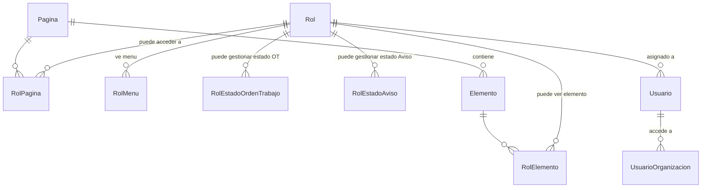

# Permisos y Seguridad – Módulo de Mantenimiento

> Análisis de **qué está realmente protegido en el servidor** frente a **qué sólo se oculta en el
> navegador**. Todas las afirmaciones marcadas `HECHO` están verificadas en el código citado.

---

## 1. Modelo de seguridad existente

### 1.1 Entidades

| Entidad | Significado | Archivo |
|---------|-------------|---------|
| `Pagina` | Tupla `(Area, Controlador, Accion)` | `AMSYS.Entidades/Seguridad/Genericos/Pagina.cs` |
| `Elemento` | Control dentro de una página (botón, pestaña) | `…/Elemento.cs` |
| `Rol` | Agrupa páginas, elementos, menús y estados permitidos | `…/Rol.cs` |
| `RolEstadoOrdenTrabajo` / `RolEstadoAviso` | Estados que el rol puede aplicar | `…/RolEstado*.cs` |
| `UsuarioOrganizacion` | Alcance organizacional del usuario | — |

> **HECHO**: `Rol` **no tiene `EmpresaId`**. Los roles son globales a toda la instalación
> multi-empresa.

### 1.2 Filtros de ASP.NET

| Filtro | Qué hace | Archivo |
|--------|----------|---------|
| `FiltroSession` | **Autenticación**. Verifica que exista sesión y revalida `TokenWeb` contra BD en cada request. Aplicado a nivel de **clase** en todos los controladores de `Areas/Gestion`. | `Commons/Session/FiltroSession.cs` |
| `FiltroAccion` | **Autorización**. Compara `/{area}/{controlador}/{accion}` contra `user.Paginas`. Aplicado **acción por acción**, y sólo en algunas. | `Commons/Session/FiltroAccion.cs` |
| `FiltroToken` | **Autenticación JWT** para `/Api` y `AMSYS.WebAPI`. Sólo valida firma + `TokenMovil` en BD. **No hace ninguna autorización.** | `Commons/Token/FiltroToken.cs` |

---

## 2. Matriz de protección real — Área Gestión (Mantenimiento)

Leyenda: 🔒 `[FiltroAccion]` presente · 🔓 sólo `FiltroSession` (cualquier usuario autenticado)

### 2.1 HojaRuta
| Acción | Verbo | Protección | Tenant |
|--------|-------|:----------:|--------|
| `Index` | GET | 🔒 | — |
| `Nuevo` | GET | 🔒 | — |
| `Nuevo` | **POST** | 🔓 | ✅ |
| `Editar` | GET | 🔒 | ❌ **sin `EmpresaId`** |
| `Editar` | **POST** | 🔓 | ✅ |
| `Ver` | GET | 🔒 | ✅ |
| `Listar` | GET | 🔓 | ✅ |

### 2.2 Seccion
| Acción | Verbo | Protección | Tenant |
|--------|-------|:----------:|--------|
| `Index` | GET | 🔒 | — |
| `Nuevo` | GET | 🔒 | ✅ |
| `NuevoPorHR` | GET | 🔒 (`Accion = "Nuevo"`) | — |
| `Nuevo` | **POST** | 🔓 | ✅ raíz / ❌ hijos |
| `Editar` | GET | 🔒 | ✅ |
| `Editar` | **POST** | 🔓 | ✅ raíz / ❌ hijos |
| `Listar` | GET | 🔓 | ✅ |
| `Seleccionar` | GET | 🔓 | — |
| `Buscar` | GET | 🔓 | ✅ |

### 2.3 PlanMantenimiento
| Acción | Verbo | Protección | Tenant |
|--------|-------|:----------:|--------|
| `Index` | GET | 🔒 | — |
| `Nuevo` | GET | 🔒 | ✅ |
| `Nuevo` | **POST** | 🔓 | ✅ raíz / ❌ secciones |
| `Editar` | GET | 🔒 | ✅ |
| `Editar` | **POST** | 🔓 | ✅ raíz / ❌ secciones |
| `Asignar` | GET | 🔒 | ✅ |
| `Ver` | GET | 🔒 | ✅ |
| `Seleccionar` | GET | 🔓 | — |
| `Listar` | GET | 🔓 | ✅ |

### 2.4 PlanMantenimientoEquipo — **ninguna acción protegida**
| Acción | Verbo | Protección | Tenant |
|--------|-------|:----------:|--------|
| `Nuevo` | GET | 🔓 | ✅ |
| `Nuevo` | POST | 🔓 | ✅ (vía plan) |
| `Eliminar` | POST | 🔓 | ✅ (`ContarAsync` con `EmpresaId`) |
| `Editar` | GET | 🔓 | ✅ |
| `Editar` | **POST** | 🔓 | ❌ **`BuscarPorIdAsync(model.Id)` sin `EmpresaId`** |
| `Listar` | GET | 🔓 | ✅ |

### 2.5 PlanMantenimientoUbicacion — **ninguna acción protegida**
Idéntica a 2.4, con el mismo fallo de tenant en `POST Editar` y **sin** la validación de duplicado.

### 2.6 OrdenTrabajo
| Acción | Verbo | Protección | Tenant |
|--------|-------|:----------:|--------|
| `Index` | GET | 🔒 | — |
| `Nuevo` / `NuevoPorAviso` / `NuevoPorOrdenTrabajo` / `NuevoPorUbicacion` / `NuevoPorEquipo` | GET | 🔒 | ✅ |
| `Nuevo` | **POST** | 🔓 | ✅ |
| `Editar` | GET | 🔒 | ✅ |
| `Editar` | **POST** | 🔓 | ✅ |
| `Notificar` | GET | 🔒 | ✅ |
| `Notificar` | **POST** | 🔓 | ✅ |
| `Ver` | GET | 🔒 | ✅ |
| `ReportePdf` | GET | 🔒 | ✅ |
| `Previsualizar` | GET | 🔒 | ✅ |
| `Previsualizar` | **POST** (genera órdenes reales) | 🔓 | ✅ |
| `PrevisualizarExcel` | POST | 🔓 | ✅ |
| `Generar` | **POST** (genera órdenes reales) | 🔓 | ✅ |
| `ExportarExcel` | POST | 🔓 | ✅ |
| `Listar` | GET | 🔓 | ✅ + org |
| `SeleccionarUno` | GET | 🔓 | — |
| `Kanban` | GET | 🔓 (**`[FiltroAccion]` comentado**) | — |
| `KanbanColumna` / `KanbanConteo` | GET | 🔓 | ✅ + org |
| `KanbanMover` | **POST** | 🔓 | ✅ |

---

## 3. Vulnerabilidades identificadas

### SEC-01 — CRITICAL — Ningún POST del módulo exige permiso de acción
- **HECHO**: en `Areas/Gestion`, **cero** acciones `[HttpPost]` llevan `[FiltroAccion]`.
- **Consecuencia**: cualquier usuario con sesión válida — incluido un técnico cuyo rol sólo tiene
  la página `OrdenTrabajo/Notificar` — puede, con una petición HTTP directa:
  - crear/modificar Planes de Mantenimiento, Hojas de Ruta y Secciones,
  - asignar y eliminar equipos de un plan,
  - **generar masivamente órdenes de trabajo** (`POST /Gestion/OrdenTrabajo/Generar`),
  - cambiar el estado de cualquier OT de su empresa.
- **Por qué es explotable con facilidad**: las acciones GET protegidas devuelven `401`, pero el
  formulario y el endpoint POST están documentados en el propio JS de las vistas a las que sí
  tiene acceso.
- **Tarea**: `MNT-001`

### SEC-02 — CRITICAL — IDOR entre empresas en las asignaciones de plan
- **HECHO**: `PlanMantenimientoEquipoController.Editar(POST)` y
  `PlanMantenimientoUbicacionController.Editar(POST)` reciben `model.Id` y lo resuelven con
  `BuscarPorIdAsync(model.Id)` — **sin `EmpresaId`**. `PlanMantenimientoEquipoLogica.ActualizarAsync`
  también resuelve con `GetOne(x => x.Id == entidad.Id)` sin filtro de tenant.
- **Consecuencia**: un usuario de la empresa A puede reiniciar el ciclo de mantenimiento
  (`PosicionActual`, `ContadorActual`, `UltimaEjecucion`) de un equipo de la empresa B, iterando IDs.
- **Tarea**: `MNT-028`

### SEC-03 — HIGH — IDOR de lectura en `HojaRuta/Editar`
- **HECHO**: `HojaRutaLogica.BuscarPorIdAsync(int id, …)` ejecuta
  `GetOneAsync(x => x!.Id == id)` sin `EmpresaId`. La acción `Ver` **sí** compara
  `_.EmpresaId != usuario.EmpresaId`; la acción `Editar` **no**.
- **Consecuencia**: fuga del código y la descripción de hojas de ruta de otras empresas.
- **Tarea**: `MNT-021`

### SEC-04 — HIGH — Inyección de FKs de otra empresa (mass assignment)
- **HECHO**: los ViewModels bindean directamente arrays de **entidades de dominio**
  (`PlanMantenimientoSeccion[]`, `Tarea[]`, `SeccionMaterial[]`, `SeccionServicio[]`) desde el
  request. El servidor sólo valida `Id > 0`; **nunca** comprueba que la FK pertenezca a la empresa
  del usuario.
- **FKs afectadas**: `SeccionId`, `HojaRutaId`, `PrioridadId`, `TipoMantenimientoId`,
  `TallerResponsableId`, `TipoTareaId`, `EspecialidadId`, `SistemaId`, `ParteId`, `MaterialId`,
  `ServicioId`, `EquipoId`, `UbicacionId`.
- **Consecuencias**:
  1. Un plan de la empresa A puede referenciar una sección de la empresa B → al generar la OT se
     copian las tareas y materiales ajenos (**fuga de datos cruzada**).
  2. Al bindear la entidad completa se acepta también un `Id` arbitrario en los hijos.
- **Tarea**: `MNT-022`

### SEC-05 — HIGH — Los estados permitidos por Rol no se aplican en ningún sitio
- **HECHO**: `Rol.EstadosOrdenTrabajo` y `Rol.EstadosAviso` se configuran en `Seguridad/Rol/Editar`,
  se cargan a la sesión en `AccountController.cs:82-83` y se exponen en
  `UserInformation.cs:21-22`. Una búsqueda global de `usuario.EstadosOrdenTrabajo` /
  `usuario.EstadosAviso` **no encuentra ningún consumo**.
- **Consecuencia**: el administrador cree estar restringiendo qué estados puede aplicar cada rol
  (p. ej. impedir que un técnico haga `CIERRE_TOTAL`), pero la restricción **no existe**.
  Es una falsa sensación de seguridad, peor que no tener la funcionalidad.
- **Tarea**: `MNT-002`

### SEC-06 — MEDIUM — Los permisos a nivel de Elemento son código muerto
- **HECHO**: `FiltroAccion` calcula `ViewBag.Elements = user.Elementos.Where(x => x.Id == page.Id)`.
  Una búsqueda de `ViewBag.Elements` en todas las vistas `.cshtml` devuelve **0 resultados**.
- **Consecuencia**: el granulado fino de permisos (mostrar/ocultar botones por rol) está definido
  en el modelo y en la UI de administración, pero no tiene efecto.
- **Nota adicional**: el filtro compara `x.Id == page.Id`, es decir el `Id` de `Elemento` contra el
  `Id` de `Pagina`. Debería ser `x.PaginaId == page.Id`. `INFERENCIA` basada en el modelo
  (`Elemento.PaginaId`).
- **Tarea**: `MNT-034`

### SEC-07 — MEDIUM — Sin protección CSRF
- **HECHO**: ningún POST del módulo usa `[ValidateAntiForgeryToken]`, y las vistas no emiten
  `@Html.AntiForgeryToken()`. El envío es `application/x-www-form-urlencoded`, formato admitido por
  formularios cross-origin.
- **Mitigación parcial existente**: la sesión se valida contra `TokenWeb` en BD, pero eso no impide
  CSRF (la cookie de sesión viaja igual).
- **Tarea**: `MNT-035`

### SEC-08 — MEDIUM — La API móvil no tiene ninguna autorización
- **HECHO**: `FiltroToken` sólo autentica. Ningún endpoint de `AMSYS.WebAdmin/Api` ni de
  `AMSYS.WebAPI` verifica página, rol ni estado permitido.
- **Consecuencia**: cualquier usuario con app móvil puede llamar `POST /api/OrdenTrabajo/guardar`,
  `/editar` y `/notificar` sobre cualquier OT de su empresa.
- **Aspecto positivo**: el aislamiento **multi-tenant sí está bien resuelto** en la API (siempre
  filtra por el claim `EmpresaId`).
- **Tarea**: `MNT-036`

### SEC-09 — LOW — Fuga de mensajes internos de excepción
- **HECHO**: `ExportarExcel` y `PrevisualizarExcel` devuelven `BadRequest(ex.Message)`.
- **Consecuencia**: rutas de archivos del servidor y detalles de EF pueden llegar al cliente.

### SEC-10 — LOW — Acciones GET sin verbo explícito
- **HECHO**: las acciones sin `[HttpPost]` aceptan cualquier verbo HTTP. Combinado con SEC-07,
  amplía la superficie de ataque.

### SEC-11 — LOW — `Kanban()` con `[FiltroAccion]` comentado
- **HECHO**: `// [FiltroAccion]` en `OrdenTrabajo.Controller.cs`. La pantalla Kanban es accesible
  para cualquier usuario autenticado aunque su rol no la tenga asignada.

---

## 4. Diferencias frontend vs backend (resumen)

| Restricción | ¿Se muestra en la UI? | ¿Se aplica en el servidor? |
|-------------|:---------------------:|:--------------------------:|
| Menú/página según rol | ✅ (`TreeMenu`, `user.Menus`) | ✅ sólo en acciones GET marcadas |
| Botones según rol (`Elemento`) | ❌ (código muerto) | ❌ |
| Estados de OT permitidos por rol | ❌ | ❌ |
| Transición de estado válida | ✅ (`EstadosHabilitados()` en el `<select>`) | ❌ salvo en `KanbanMover` |
| `PuedoEditar` / `PuedoNotificar` / `PuedoModificarObjetoTecnico` | ✅ | ❌ |
| Aislamiento por empresa | — | ✅ mayoritariamente (excepciones SEC-02, SEC-03, SEC-04) |
| Aislamiento por organización | — | ✅ sólo en `OrdenTrabajo/Listar` y Kanban |

> **Conclusión**: el módulo tiene **autenticación sólida** y **aislamiento multi-tenant en la
> mayoría de rutas**, pero la **autorización es esencialmente decorativa** en todo lo que modifica
> datos.

---

## 5. Orden de remediación recomendado

1. `MNT-001` — `[FiltroAccion]` en todos los POST (mayor superficie cerrada con el menor cambio).
2. `MNT-028` — cerrar el IDOR entre empresas de las asignaciones.
3. `MNT-021` — cerrar el IDOR de lectura de `HojaRuta`.
4. `MNT-022` — validar la pertenencia de todas las FKs recibidas.
5. `MNT-002` — decidir con el propietario si `RolEstadoOrdenTrabajo` se aplica o se retira.
6. `MNT-036` — autorización en la API móvil.
7. `MNT-035` — CSRF.
8. `MNT-034` — permisos de elemento (aplicar o eliminar).
