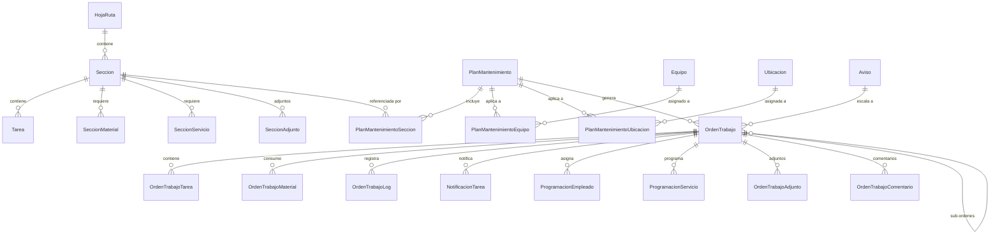
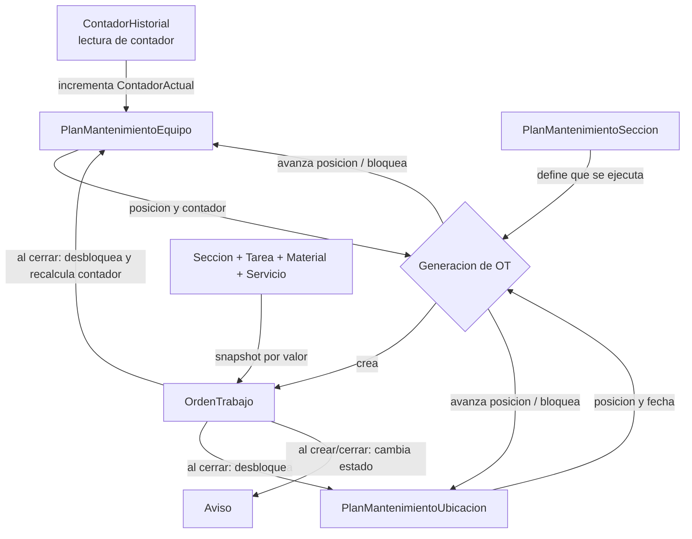

# Modelo de Dominio – Módulo de Mantenimiento

## Relaciones Verificadas

> [!IMPORTANT]
> La relación entre las entidades principales **NO** sigue una jerarquía lineal simple. La estructura real es:

```
HojaRuta (1) ──────→ (*) Seccion (1) ──────→ (*) Tarea
                           │
                    PlanMantenimientoSeccion (tabla intermedia N:M)
                           │
PlanMantenimiento (1) ──→ (*) PlanMantenimientoSeccion
PlanMantenimiento (1) ──→ (*) PlanMantenimientoEquipo
PlanMantenimiento (1) ──→ (*) PlanMantenimientoUbicacion
PlanMantenimiento (1) ──→ (*) OrdenTrabajo
```

### Diferencia con el modelo conceptual asumido

**Modelo asumido:**
```
PlanMantenimiento → HojaRuta → Sección → Tarea
```

**Modelo real:**
```
HojaRuta → Sección → Tarea  (jerarquía de plantilla)
PlanMantenimiento ←→ Sección  (N:M vía PlanMantenimientoSeccion)
PlanMantenimiento → Equipo/Ubicación  (asignación de objetos técnicos)
PlanMantenimiento → OrdenTrabajo  (generación)
```

> [!NOTE]
> **HECHO**: No existe relación directa entre `PlanMantenimiento` y `HojaRuta`. La relación es indirecta: `PlanMantenimiento` referencia `Secciones` que a su vez pertenecen opcionalmente a una `HojaRuta`.

---

## Diagrama de Relaciones



---

## Entidades Detalladas

### PlanMantenimiento

**Archivo**: [`PlanMantenimiento.cs`](file:///d:/Documentos/Alphamanufacturas/AMSYS/AMSYS/AMSYS.Entidades/Gestion/Genericos/PlanMantenimiento.cs)

| Propiedad | Tipo | Obligatorio | Descripción |
|-----------|------|-------------|-------------|
| Id | int | PK | Identificador |
| EmpresaId | int | FK | Tenant |
| UnidadMedidaServicioId | int | FK | Unidad de medida para programación (Día, Semana, Mes, Año, Contador) |
| Codigo | string | Sí | Código único del plan |
| Descripcion | string | Sí | Descripción del plan |
| Activo | bool | Sí | Si está activo para programación |
| Rutina | bool | Sí | Modo rutina (cambia cálculo de posiciones) |
| MCM | decimal | Sí | Mínimo Común Múltiplo (usado para CantidadPosiciones cuando no es rutina) |
| Intervalo | decimal | Sí | Intervalo base del plan |
| FactorPlanificacion | decimal | Sí | Días de anticipación para lanzamiento |
| CantidadPosiciones | int | Calculado | Si Rutina: max(Secciones.Intervalo). Si no: MCM / Intervalo |

**Navegaciones:**
- `Empresa` → Empresa
- `UnidadMedidaServicio` → UnidadMedidaServicio
- `Secciones` → List\<PlanMantenimientoSeccion\>
- `Equipos` → List\<PlanMantenimientoEquipo\>
- `Ubicaciones` → List\<PlanMantenimientoUbicacion\>
- `OrdenesTrabajo` → List\<OrdenTrabajo\>

**Métodos de dominio** (en [`PlanMantenimiento.Adicional.cs`](file:///d:/Documentos/Alphamanufacturas/AMSYS/AMSYS/AMSYS.Entidades/Gestion/Adicionales/PlanMantenimiento.Adicional.cs)):
- `Comportamiento()` → Diccionario posición → valor de frecuencia
- `ComportamientoConFactorPlanificacion()` → Ídem con factor descontado
- `ComportamientoConSeccion()` → Diccionario posición → SeccionIds a ejecutar
- `ComportamientoConPlanMantenimientoSeccion()` → Diccionario posición → PlanMantenimientoSeccion[] a ejecutar

> [!IMPORTANT]
> **Regla clave**: Para cada posición, se calcula qué secciones aplican: `frecuencia % (seccion.Intervalo * plan.Intervalo) == 0`. Si hay múltiples secciones, se toma la de mayor `Nivel` (absorbe las inferiores).

---

### HojaRuta

**Archivo**: [`HojaRuta.cs`](file:///d:/Documentos/Alphamanufacturas/AMSYS/AMSYS/AMSYS.Entidades/Gestion/Genericos/HojaRuta.cs)

| Propiedad | Tipo | Obligatorio | Descripción |
|-----------|------|-------------|-------------|
| Id | int | PK | Identificador |
| EmpresaId | int | FK | Tenant |
| Codigo | string | Sí | Código único |
| Descripcion | string | Sí | Descripción |
| Activo | bool | Sí | Estado activo/inactivo |

**Navegaciones:**
- `Empresa` → Empresa
- `Secciones` → List\<Seccion\>

> [!NOTE]
> **HECHO**: HojaRuta es una entidad simple tipo catálogo/plantilla. No tiene estados ni ciclo de vida complejo. Solo agrupa secciones.

---

### Seccion

**Archivo**: [`Seccion.cs`](file:///d:/Documentos/Alphamanufacturas/AMSYS/AMSYS/AMSYS.Entidades/Gestion/Genericos/Seccion.cs)

| Propiedad | Tipo | Obligatorio | Descripción |
|-----------|------|-------------|-------------|
| Id | int | PK | Identificador |
| HojaRutaId | int? | FK (nullable) | Hoja de ruta padre (puede ser null) |
| EmpresaId | int | FK | Tenant |
| Codigo | string | Sí | Código |
| Nombre | string | Sí | Nombre descriptivo |
| Activo | bool | Sí | Estado activo/inactivo |

**Navegaciones:**
- `HojaRuta` → HojaRuta (nullable)
- `Empresa` → Empresa
- `Tareas` → List\<Tarea\>
- `Materiales` → List\<SeccionMaterial\>
- `Servicios` → List\<SeccionServicio\>
- `PlanesMantenimiento` → List\<PlanMantenimientoSeccion\>
- `Adjuntos` → List\<SeccionAdjunto\>
- `OrdenTrabajoTareas` → List\<OrdenTrabajoTarea\>
- `OrdenTrabajoMateriales` → List\<OrdenTrabajoMaterial\>

> [!NOTE]
> **HECHO**: `HojaRutaId` es **nullable**, lo que significa que una Sección puede existir sin pertenecer a una Hoja de Ruta. Esto es relevante para secciones independientes.

---

### Tarea

**Archivo**: [`Tarea.cs`](file:///d:/Documentos/Alphamanufacturas/AMSYS/AMSYS/AMSYS.Entidades/Gestion/Genericos/Tarea.cs)

| Propiedad | Tipo | Obligatorio | Descripción |
|-----------|------|-------------|-------------|
| Id | int | PK | Identificador |
| SeccionId | int | FK | Sección padre |
| TipoTareaId | int | FK | Tipo de tarea |
| EspecialidadId | int | FK | Especialidad requerida |
| SistemaId | int? | FK (nullable) | Sistema técnico |
| ParteId | int? | FK (nullable) | Parte del sistema |
| Orden | int | Sí | Orden de ejecución |
| Descripcion | string | Sí | Descripción de la tarea |
| Cantidad | decimal | Sí | Cantidad de trabajo |
| Duracion | decimal | Sí | Duración estimada |
| TextoAmpliado | string? | No | Texto descriptivo adicional |

**Navegaciones:**
- `Seccion` → Seccion
- `TipoTarea` → TipoTarea
- `Especialidad` → Especialidad
- `Sistema` → Sistema (nullable)
- `Parte` → Parte (nullable)

> [!NOTE]
> **HECHO**: Tarea NO tiene campo `Activo`. Una vez creada, se elimina o existe. Las tareas se eliminan y recrean completamente al actualizar una sección (patrón delete-all + re-insert).

---

### PlanMantenimientoSeccion (tabla intermedia)

**Archivo**: [`PlanMantenimientoSeccion.cs`](file:///d:/Documentos/Alphamanufacturas/AMSYS/AMSYS/AMSYS.Entidades/Gestion/Genericos/PlanMantenimientoSeccion.cs)

| Propiedad | Tipo | Obligatorio | Descripción |
|-----------|------|-------------|-------------|
| Id | int | PK | Identificador |
| PlanMantenimientoId | int | FK | Plan padre |
| SeccionId | int | FK | Sección vinculada |
| PrioridadId | int | FK | Prioridad de la OT generada |
| TipoMantenimientoId | int | FK | Tipo de mantenimiento |
| TallerResponsableId | int | FK | Taller responsable |
| EquipoDetenido | bool | Sí | Si requiere equipo detenido |
| Intervalo | decimal | Sí | Frecuencia relativa (múltiplo del intervalo base) |
| Nivel | int | Sí | Nivel jerárquico (mayor nivel absorbe menores) |

---

### PlanMantenimientoEquipo

**Archivo**: [`PlanMantenimientoEquipo.cs`](file:///d:/Documentos/Alphamanufacturas/AMSYS/AMSYS/AMSYS.Entidades/Gestion/Genericos/PlanMantenimientoEquipo.cs)

| Propiedad | Tipo | Obligatorio | Descripción |
|-----------|------|-------------|-------------|
| Id | int | PK | Identificador |
| PlanMantenimientoId | int | FK | Plan padre |
| EquipoId | int | FK | Equipo asignado |
| Registro | DateTime | Sí | Fecha de registro |
| Inicio | DateTime? | No | Fecha de inicio de programación |
| PosicionInicio | int | Sí | Posición inicial en el ciclo |
| PosicionActual | int | Sí | Posición actual (se incrementa en cada lanzamiento) |
| ContadorInicio | decimal? | No | Valor de contador al inicio |
| ContadorActual | decimal? | No | Valor de contador actual |
| UltimaEjecucion | DateTime? | No | Fecha de última ejecución |
| TipoProgramacion | TipoProgramacion | Sí | FIJA o FLOTANTE |
| Bloqueado | bool | Sí | Si está bloqueado para nuevos lanzamientos |

---

### PlanMantenimientoUbicacion

**Archivo**: [`PlanMantenimientoUbicacion.cs`](file:///d:/Documentos/Alphamanufacturas/AMSYS/AMSYS/AMSYS.Entidades/Gestion/Genericos/PlanMantenimientoUbicacion.cs)

| Propiedad | Tipo | Obligatorio | Descripción |
|-----------|------|-------------|-------------|
| Id | int | PK | Identificador |
| PlanMantenimientoId | int | FK | Plan padre |
| UbicacionId | int | FK | Ubicación asignada |
| Registro | DateTime | Sí | Fecha de registro |
| Inicio | DateTime | Sí | Fecha de inicio (obligatoria, a diferencia de Equipo) |
| PosicionInicio | int | Sí | Posición inicial |
| PosicionActual | int | Sí | Posición actual |
| UltimaEjecucion | DateTime? | No | Fecha de última ejecución |
| TipoProgramacion | TipoProgramacion | Sí | FIJA o FLOTANTE |
| Bloqueado | bool | Sí | Si está bloqueado |

---

### OrdenTrabajo

**Archivo**: [`OrdenTrabajo.cs`](file:///d:/Documentos/Alphamanufacturas/AMSYS/AMSYS/AMSYS.Entidades/Gestion/Genericos/OrdenTrabajo.cs)

| Propiedad | Tipo | Obligatorio | Descripción |
|-----------|------|-------------|-------------|
| Id | int | PK | Identificador |
| EmpresaId | int | FK | Tenant |
| UbicacionId | int | FK | Ubicación funcional |
| EquipoId | int? | FK | Equipo (opcional, puede ser solo ubicación) |
| UsuarioId | int? | FK | Usuario asignado |
| PlanMantenimientoId | int? | FK | Plan origen (null si correctiva) |
| AvisoId | int? | FK | Aviso origen (null si preventiva) |
| OrdenTrabajoPadreId | int? | FK | OT padre (para sub-órdenes) |
| TipoMantenimientoId | int? | FK | Tipo de mantenimiento |
| TallerResponsableId | int? | FK | Taller responsable |
| PrioridadId | int? | FK | Prioridad |
| CentroCostoId | int? | FK | Centro de costo |
| CuentaContableId | int? | FK | Cuenta contable |
| OrganizacionId | int | FK | Organización |
| UnidadMedidaServicioId | int? | FK | UMS del contador |
| Codigo | string | Sí | Código: `OT-{año}-{secuencial:5 dígitos}` |
| Descripcion | string | Sí | Descripción |
| Estado | EstadoOrdenTrabajo | Sí | Estado actual |
| Registro | DateTime | Sí | Fecha de creación |
| Anio, Mes, Dia | int | Sí | Descomposición de fecha para consultas |
| InicioProgramado | DateTime? | No | Fecha programada de inicio |
| FinProgramado | DateTime? | No | Fecha programada de fin |
| InicioEjecutado | DateTime? | No | Fecha real de inicio |
| FinEjecutado | DateTime? | No | Fecha real de fin |
| Duracion | decimal? | No | Duración real |
| Detenido | bool | Sí | Si requiere equipo detenido |
| EnEjecucion | bool | Sí | Si está en ejecución activa |
| TotalTareas | int | Sí | Total de tareas |
| TotalTareasEjecutadas | int | Sí | Tareas ejecutadas |
| Comentario | string? | No | Comentario general |
| Observacion | string? | No | Observación |
| ValorLanzamiento | decimal? | No | Valor de contador al lanzamiento |
| ValorLanzamientoPlan | decimal? | No | Valor planificado al lanzamiento |
| ValorPosicionPlan | decimal? | No | Valor de posición del plan |
| ValorEjecucion | decimal? | No | Valor de contador al ejecutar |
| FechaLanzamiento | DateTime? | No | Fecha de lanzamiento programada |
| FechaEjecucion | DateTime? | No | Fecha de ejecución |
| PosicionLanzamiento | int? | No | Posición del plan al lanzar |
| CodigoExterno | string? | No | Código en sistema externo |
| Liberado | bool | Sí | Si está liberada para ejecución |
| PuedeEjecutar | bool | Sí | Flag de ejecución |

---

## Enumeraciones

### EstadoOrdenTrabajo
```
EMITIDO = 0
// PROGRAMADO = 1  (comentado/eliminado)
CIERRE_TECNICO = 2
CIERRE_TOTAL = 3
ANULADO = 4
```

### TipoProgramacion
```
FIJA = 0
FLOTANTE = 1
```

### EstadoAviso
```
EMITIDO = 0
APROBADO = 1
ATENDIDO = 2
FINALIZADO = 3
RECHAZADO = 4
```

### TipoAviso
```
SOLICITUD_TRABAJO = 0
FALLA = 1
// PARADA (comentado)
```

### TipoUms (no vista directamente, inferida del código)
```
CALENDARIO
CONTADOR
```

### TipoCalendario (inferida del código)
```
DIA
SEMANA
MES
ANIO
```

---

## Cardinalidades Verificadas

| Relación | Cardinalidad | Evidencia |
|----------|-------------|-----------|
| HojaRuta → Seccion | 1:N | `HojaRuta.Secciones`, `Seccion.HojaRutaId` |
| Seccion → Tarea | 1:N | `Seccion.Tareas`, `Tarea.SeccionId` (obligatorio) |
| Seccion → SeccionMaterial | 1:N | `Seccion.Materiales` |
| Seccion → SeccionServicio | 1:N | `Seccion.Servicios` |
| PlanMantenimiento → PlanMantenimientoSeccion | 1:N | `PlanMantenimiento.Secciones` |
| Seccion → PlanMantenimientoSeccion | 1:N | `Seccion.PlanesMantenimiento` |
| **PlanMantenimiento ↔ Seccion** | **N:M** | Vía `PlanMantenimientoSeccion` |
| PlanMantenimiento → PlanMantenimientoEquipo | 1:N | `PlanMantenimiento.Equipos` |
| PlanMantenimiento → PlanMantenimientoUbicacion | 1:N | `PlanMantenimiento.Ubicaciones` |
| PlanMantenimiento → OrdenTrabajo | 1:N | `PlanMantenimiento.OrdenesTrabajo` |
| OrdenTrabajo → OrdenTrabajo | 1:N (self) | `OrdenTrabajoPadreId` |
| Aviso → OrdenTrabajo | 1:N | `OrdenTrabajo.AvisoId` |
| OrdenTrabajo → OrdenTrabajoTarea | 1:N | `OrdenTrabajo.Tareas` |
| Seccion.HojaRutaId | **nullable** | Una sección puede existir sin hoja de ruta |

---

## Ampliación del análisis (2026-08-29)

Esta sección complementa el modelo anterior con las relaciones, ciclos de vida y reglas verificadas
durante el análisis completo del módulo. Todo lo aquí documentado está contrastado con el código.

### Corrección de cardinalidades

| Relación | Documentado antes | Verificado ahora |
|----------|-------------------|------------------|
| `Seccion → Tarea` | 1:N | 1:N **con dueño de ciclo de vida**: la tarea sólo existe dentro de la sección y se borra y recrea en cada guardado (`BR-SE-003`) |
| `PlanMantenimiento ↔ Seccion` | N:M | N:M **con metadata en la relación**: `PlanMantenimientoSeccion` lleva prioridad, tipo de mantenimiento, taller, intervalo relativo y nivel |
| `OrdenTrabajoTarea → Tarea` | no documentada | **No existe FK.** `OrdenTrabajoTarea` guarda un snapshot por valor y sólo conserva `SeccionId` |
| `Contador → PlanMantenimientoEquipo` | no documentada | Relación **funcional, no declarada**: registrar una lectura actualiza `ContadorActual` de las asignaciones no bloqueadas (`BR-GE-010`) |

### Diagrama de dependencias funcionales (no de FKs)

Muestra qué entidad **modifica el estado** de cuál. Es el mapa de acoplamientos reales del módulo.



> **HECHO**: el cierre de una Orden de Trabajo **escribe** en la programación del Plan. La generación
> y la ejecución no son dos procesos independientes: están acoplados en ambos sentidos.

### Ciclo de vida por entidad

| Entidad | Crear | Modificar | Eliminar | Estados |
|---------|-------|-----------|----------|---------|
| `HojaRuta` | `POST HojaRuta/Nuevo` | `POST HojaRuta/Editar` | **no existe** | sólo `Activo` |
| `Seccion` | `POST Seccion/Nuevo` (o duplicar con `?id=N`) | `POST Seccion/Editar` (borra y recrea sus hijos) | **no existe** | sólo `Activo` |
| `Tarea` | dentro de `Seccion` | dentro de `Seccion` (recreada) | dentro de `Seccion` | **ninguno** (no tiene `Activo`) |
| `PlanMantenimiento` | `POST PlanMantenimiento/Nuevo` | `POST PlanMantenimiento/Editar` (borra y recrea sus secciones) | **no existe** | sólo `Activo` |
| `PlanMantenimientoEquipo` | `POST .../Nuevo` | `POST .../Editar` (**reinicia el ciclo**) | `POST .../Eliminar` | `Bloqueado` sí/no |
| `PlanMantenimientoUbicacion` | ídem | ídem | ídem | `Bloqueado` sí/no |
| `OrdenTrabajo` | generación por plan, desde aviso, o manual | `Editar`, `Notificar`, `KanbanMover` | **no existe** (se anula) | `EMITIDO`, `CIERRE_TECNICO`, `CIERRE_TOTAL`, `ANULADO` |

> **HECHO**: **ninguna** de las cuatro entidades principales se puede eliminar. El único mecanismo de
> retirada es `Activo = false`, y `Tarea` ni siquiera dispone de él.

### Campos calculados y su origen

| Campo | Calculado en | Fórmula |
|-------|-------------|---------|
| `PlanMantenimiento.MCM` | **controlador** `PlanMantenimientoController` | `mcm(Secciones.Intervalo) * Intervalo` |
| `PlanMantenimiento.CantidadPosiciones` | **lógica** `PlanMantenimientoLogica` | `Rutina ? max(Secciones.Intervalo) : MCM / Intervalo` |
| `OrdenTrabajo.Codigo` | lógica | `OT-{año}-{COUNT+1 : D5}` — no es una secuencia (`MNT-004`) |
| `OrdenTrabajo.TotalTareas` | lógica, al guardar | conteo de `OrdenTrabajoTarea` insertadas |
| `OrdenTrabajo.TotalTareasEjecutadas` | lógica, al notificar | conteo de notificaciones |
| `OrdenTrabajo.CalcularPorcentaje()` | entidad | `TotalTareasEjecutadas / TotalTareas * 100` |
| `PlanMantenimientoEquipo.ContadorActual` | lógica de generación **y** de lecturas de contador | ver `BR-GE-010` |

> **HALLAZGO**: `MCM` y `CantidadPosiciones` se calculan en **capas distintas**. Cualquier ruta nueva
> que persista un plan sin pasar por el controlador producirá un `MCM` incorrecto.

### Relaciones nullable y su significado

| FK | Nullable | Significado verificado |
|----|:--------:|------------------------|
| `Seccion.HojaRutaId` | ✅ | Sección independiente, sin agrupador. Permitido y frecuente (`BR-SE-001`) |
| `Tarea.SistemaId` / `ParteId` | ✅ | Tarea no asociada a un sistema técnico concreto |
| `OrdenTrabajo.EquipoId` | ✅ | OT sobre una ubicación, sin equipo concreto |
| `OrdenTrabajo.PlanMantenimientoId` | ✅ | OT correctiva o manual |
| `OrdenTrabajo.AvisoId` | ✅ | OT preventiva o manual |
| `OrdenTrabajo.OrdenTrabajoPadreId` | ✅ | OT raíz (sin reglas de jerarquía, ver `MNT-033`) |
| `PlanMantenimientoEquipo.Inicio` | ✅ | Asignación a un plan por contador (no usa fechas) |
| `PlanMantenimientoUbicacion.Inicio` | ❌ | **Obligatorio**: las ubicaciones sólo soportan calendario (`BR-GE-004`) |
| `PlanMantenimientoEquipo.ContadorInicio` | ✅ | Asignación a un plan por calendario |

### Invariantes NO garantizados por la base de datos

Verificado sobre `AMSYSContextoModelSnapshot.cs`: **el modelo no declara ni un solo índice único**.
Estos invariantes existen sólo como validación en controlador, o no existen en absoluto:

| Invariante | Dónde se comprueba hoy |
|------------|------------------------|
| `HojaRuta.Codigo` único | **en ningún sitio** |
| `Seccion.Codigo` único | **en ningún sitio** |
| `PlanMantenimiento.Codigo` único | **en ningún sitio** |
| `OrdenTrabajo.Codigo` único | **en ningún sitio** (y se genera con `COUNT+1`) |
| `(PlanMantenimientoId, EquipoId)` único | validación en el controlador, sin índice |
| `(PlanMantenimientoId, UbicacionId)` único | **en ningún sitio** |
| `(PlanMantenimientoId, SeccionId)` único | **en ningún sitio** |
| `Tarea.Orden` único por sección | **en ningún sitio** |
| Campos `string` obligatorios | validación en el controlador; en BD son `text` anulables |
| Concurrencia optimista | **inexistente**: gana la última escritura |

Ver `MNT-004`, `MNT-010`, `MNT-017`, `MNT-024`, `MNT-027`.

### Enumeraciones — corrección

`TipoUms` tiene **tres** valores, no dos como se documentó inicialmente:

```csharp
public enum TipoUms { CALENDARIO, CONTADOR, PUNTO_MEDIDA }
```

`PUNTO_MEDIDA` **no está implementado** en ninguna ruta de generación, ni para equipos ni para
ubicaciones. `PlanMantenimientoController.Index` y `Nuevo` filtran explícitamente los desplegables a
`[CALENDARIO, CONTADOR]`, por lo que no es seleccionable desde la interfaz de planes.

`EstadoOrdenTrabajo` tiene un **hueco deliberado** en el valor `1` (`PROGRAMADO`, comentado en el
commit `fc6c6f8`). El bucle de creación de logs recorre `0..(int)Estado` e inserta un log con ese
valor inexistente (`MNT-011`). **No reintroducir el valor 1.**
