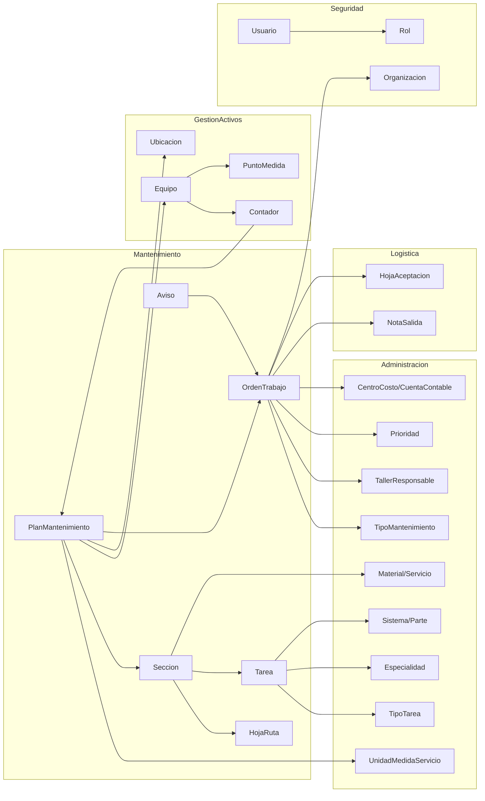

# Análisis de Entidades y Procesos Operativos – Mantenimiento

> El nombre del archivo (`orders.md`) se conserva por la estructura acordada.
> Su contenido cubre **todas las entidades operativas del módulo de Mantenimiento**:
> Hoja de Ruta, Sección, Tarea, Plan de Mantenimiento, asignaciones y Orden de Trabajo.

---

## 1. Mapa de archivos por entidad

| Entidad | Entidad | Config EF | Repositorio | Lógica | Controller MVC | Vistas |
|---------|---------|-----------|-------------|--------|----------------|--------|
| HojaRuta | `Entidades/Gestion/Genericos/HojaRuta.cs` | `Configuraciones/Gestion/HojaRuta.Config.cs` | `Repositorios/Gestion/HojaRuta.Repositorio.cs` | `Logicas/Gestion/HojaRuta.Logica.cs` | `Areas/Gestion/Controllers/HojaRuta.Controller.cs` | `Views/HojaRuta/{Index,Ver,_Nuevo,_Editar}` |
| Seccion | `…/Seccion.cs` | `…/Seccion.Config.cs` | `…/Seccion.Repositorio.cs` | `…/Seccion.Logica.cs` | `…/Seccion.Controller.cs` | `Views/Seccion/{Index,Nuevo,Editar,_Seleccionar}` |
| Tarea | `…/Tarea.cs` | `…/Tarea.Config.cs` | `…/Tarea.Repositorio.cs` | *(sin lógica propia)* | *(sin controller propio)* | *(embebida en Seccion)* |
| PlanMantenimiento | `…/PlanMantenimiento.cs` + `Adicionales/PlanMantenimiento.Adicional.cs` | `…/PlanMantenimiento.Config.cs` | `…/PlanMantenimiento.Repositorio.cs` | `…/PlanMantenimiento.Logica.cs` (1410 LOC) | `…/PlanMantenimiento.Controller.cs` | `Views/PlanMantenimiento/{Index,Nuevo,Editar,Asignar,Ver,_Seleccionar}` |
| PlanMantenimientoSeccion | `…/PlanMantenimientoSeccion.cs` | `…/PlanMantenimientoSeccion.Config.cs` | `…/PlanMantenimientoSeccion.Repositorio.cs` | *(dentro de PlanMantenimiento)* | *(dentro de PlanMantenimiento)* | *(tabla en Nuevo/Editar)* |
| PlanMantenimientoEquipo | `…/PlanMantenimientoEquipo.cs` | `…/PlanMantenimientoEquipo.Config.cs` | `…/PlanMantenimientoEquipo.Repositorio.cs` | `…/PlanMantenimientoEquipo.Logica.cs` | `…/PlanMantenimientoEquipo.Controller.cs` | `Views/PlanMantenimientoEquipo/{_Nuevo,_Editar}` |
| PlanMantenimientoUbicacion | `…/PlanMantenimientoUbicacion.cs` | `…/PlanMantenimientoUbicacion.Config.cs` | `…/PlanMantenimientoUbicacion.Repositorio.cs` | `…/PlanMantenimientoUbicacion.Logica.cs` | `…/PlanMantenimientoUbicacion.Controller.cs` | `Views/PlanMantenimientoUbicacion/{_Nuevo,_Editar}` |
| OrdenTrabajo | `…/OrdenTrabajo.cs` + `Adicionales/OrdenTrabajo.Adicional.cs` | `…/OrdenTrabajo.Config.cs` | `…/OrdenTrabajo.Repositorio.cs` | `…/OrdenTrabajo.Logica.cs` (1354 LOC) | `…/OrdenTrabajo.Controller.cs` + `Api/Controllers/OrdenTrabajoController.cs` | `Views/OrdenTrabajo/{Index,Nuevo,Editar,Notificar,Ver,Kanban,Previsualizar}` |
| Aviso | `…/Aviso.cs` + `Adicionales/Aviso.Adicional.cs` | `…/Aviso.Config.cs` | `…/Aviso.Repositorio.cs` | `…/Aviso.Logica.cs` | `…/Aviso.Controller.cs` + `Api/Controllers/AvisoController.cs` | `Views/Aviso/{Index,Nuevo,Editar,Gestionar,Ver,MisAvisos}` |

Entidades satélite descubiertas: `SeccionMaterial`, `SeccionServicio`, `SeccionAdjunto`,
`OrdenTrabajoTarea`, `OrdenTrabajoMaterial`, `OrdenTrabajoAdjunto`, `OrdenTrabajoComentario`,
`OrdenTrabajoCosto`, `OrdenTrabajoLog`, `ProgramacionEmpleado`, `ProgramacionServicio`,
`ProgramacionSocioNegocio`, `Notificacion*` (10 tipos), `Contador`, `ContadorHistorial`,
`PuntoMedida`, `AlertaPuntoMedida`, `Parada`, `ParadaEquipo`, `Confiabilidad`, `Indicador`.

---

## 2. Hoja de Ruta

### Modelo
| Propiedad | Tipo | Obligatorio en BD | Validado en servidor |
|-----------|------|-------------------|----------------------|
| `Id` | `int` | PK | — |
| `EmpresaId` | `int` | FK | se asigna del usuario |
| `Codigo` | `string` | no (sin `IsRequired`) | sí, no vacío |
| `Descripcion` | `string` | no | sí, no vacío |
| `Activo` | `bool` | sí | — |
| `Secciones` | `List<Seccion>?` | nav | — |

### Operaciones
| Operación | Endpoint | Autorización | Filtro de tenant |
|-----------|----------|--------------|------------------|
| Listar | `GET /Gestion/HojaRuta/Listar` | sólo sesión | ✅ `filtro.EmpresaId` |
| Crear | `POST /Gestion/HojaRuta/Nuevo` | **sólo sesión** | ✅ asigna `EmpresaId` |
| Editar (form) | `GET /Gestion/HojaRuta/Editar` | `[FiltroAccion]` | ❌ **`BuscarPorIdAsync(id)` sin `EmpresaId`** |
| Editar (guardar) | `POST /Gestion/HojaRuta/Editar` | **sólo sesión** | ✅ `GetOne(Id && EmpresaId)` |
| Ver detalle | `GET /Gestion/HojaRuta/Ver` | `[FiltroAccion]` | ✅ compara `EmpresaId` |
| Eliminar | — | **no existe** | — |

### Problemas encontrados
| ID | Sev. | Categoría | Resumen |
|----|------|-----------|---------|
| MNT-001 | CRITICAL | SECURITY | `POST Nuevo/Editar` sin `[FiltroAccion]` |
| MNT-021 | HIGH | SECURITY | `GET Editar` expone hojas de ruta de otras empresas (IDOR) |
| MNT-048 | MEDIUM | UX | `Codigo` duplicado sin aviso. **`D-03`: la duplicación es válida**; falta la alerta informativa |
| MNT-023 | MEDIUM | PERFORMANCE | `BuscarPorIdAsync(conDetalles:true)` carga todas las tareas, materiales y servicios de todas las secciones sin paginar |

---

## 3. Sección

### Modelo
| Propiedad | Tipo | Nota |
|-----------|------|------|
| `Id` | `int` | PK |
| `HojaRutaId` | `int?` | **anulable** — ver `BR-SE-001` |
| `EmpresaId` | `int` | tenant |
| `Codigo` | `string` | obligatorio sólo por validación de controlador |
| `Nombre` | `string` | obligatorio sólo por validación de controlador |
| `Activo` | `bool` | |
| `Tareas` | `List<Tarea>?` | 1:N |
| `Materiales` | `List<SeccionMaterial>?` | 1:N (`MaterialId`, `Cantidad`) |
| `Servicios` | `List<SeccionServicio>?` | 1:N (`ServicioId`) |
| `Adjuntos` | `List<SeccionAdjunto>?` | 1:N |
| `PlanesMantenimiento` | `List<PlanMantenimientoSeccion>?` | N:M inverso |
| `OrdenTrabajoTareas` / `OrdenTrabajoMateriales` | nav | trazabilidad hacia OT |

### Comportamiento
- **Crear** (`SeccionLogica.GuardarAsync`): inserta la sección y las colecciones hijas.
- **Actualizar** (`SeccionLogica.ActualizarAsync`): *delete-all + re-insert* de tareas, materiales
  y servicios; los adjuntos **sólo se agregan**.
- **Consultar**: `BuscarPorIdAsync(filtro, conTareas, conMateriales, conServicios, conAdjuntos)` —
  carga selectiva por flags, cada uno con su propia consulta.
- **Duplicar**: `GET /Gestion/Seccion/Nuevo?id=N` clona la sección con `Id = 0`.
- **Eliminar**: no existe.

### Dependencias
- `Seccion → HojaRuta` (opcional)
- `Seccion → Tarea` (1:N, dueño del ciclo de vida)
- `Seccion ← PlanMantenimientoSeccion` (una sección puede estar en N planes)
- `Seccion ← OrdenTrabajoTarea.SeccionId` / `OrdenTrabajoMaterial.SeccionId`
  (referencia **histórica** desde las OT ya generadas)

### Problemas encontrados
| ID | Sev. | Categoría | Resumen |
|----|------|-----------|---------|
| MNT-001 | CRITICAL | SECURITY | `POST Nuevo/Editar` sin `[FiltroAccion]` |
| MNT-022 | HIGH | SECURITY | `HojaRutaId`, `TipoTareaId`, `EspecialidadId`, `SistemaId`, `ParteId`, `MaterialId`, `ServicioId` se aceptan del cliente sin verificar que pertenezcan a la empresa |
| MNT-014 | HIGH | DATA_INTEGRITY | El *delete-all + re-insert* cambia los `Tarea.Id` en cada guardado y los adjuntos no se pueden quitar |
| MNT-048 | MEDIUM | UX | La función "duplicar sección" conserva el código; **`D-03` lo admite**, pero debe avisarse al usuario |
| MNT-024 | MEDIUM | VALIDATION | `Tarea.Orden` no se valida: admite 0, negativos y duplicados dentro de la misma sección |
| MNT-025 | MEDIUM | CODE_QUALITY | `Validar(Nuevo)` y `Validar(Editar)` son código duplicado literal (≈45 líneas × 2) |

---

## 4. Tarea

### Modelo
| Propiedad | Tipo | Obligatorio |
|-----------|------|-------------|
| `Id` | `int` | PK |
| `SeccionId` | `int` | **sí** (no anulable) |
| `TipoTareaId` | `int` | sí (validación `> 0`) |
| `EspecialidadId` | `int` | sí (validación `> 0`) |
| `SistemaId` | `int?` | no |
| `ParteId` | `int?` | no |
| `Orden` | `int` | sin validación |
| `Descripcion` | `string` | sí |
| `Cantidad` | `decimal(20,2)` | sí (`> 0`) |
| `Duracion` | `decimal(20,2)` | sí (`> 0`) |
| `TextoAmpliado` | `string?` | no |

### Comportamiento
- No tiene controlador, lógica ni pantalla propia: se gestiona **exclusivamente** como colección
  dentro de `Seccion/Nuevo` y `Seccion/Editar` (pestaña *Tareas*).
- `TareaRepositorio` sólo expone `Listar(filtro)` con `Include` de `Especialidad`, `TipoTarea`,
  `Sistema` y `Parte`, ordenado por `Orden`.
- Al generar una OT se copia a `OrdenTrabajoTarea` **por valor** (snapshot), no por referencia:
  `SeccionId, SistemaId, ParteId, TipoTareaId, EspecialidadId, Cantidad, Duracion, Descripcion,
  TextoAmpliado`. La OT conserva `SeccionId` pero **no** `TareaId`.

### Consecuencia positiva verificada
Como la OT guarda un snapshot y no una FK a `Tarea`, el *delete-all + re-insert* de `BR-SE-003`
**no rompe** las órdenes de trabajo históricas.

### Consecuencia negativa
No existe forma de saber de qué `Tarea` original proviene una `OrdenTrabajoTarea`, ni de comparar
"lo planificado en la plantilla actual" con "lo ejecutado" a nivel de tarea individual.

### Problemas encontrados
| ID | Sev. | Categoría | Resumen |
|----|------|-----------|---------|
| MNT-014 | HIGH | DATA_INTEGRITY | Identidad de la tarea no estable entre guardados |
| MNT-024 | MEDIUM | VALIDATION | `Orden` sin validar |
| MNT-026 | LOW | TRACEABILITY | `OrdenTrabajoTarea` no referencia la `Tarea` origen |

---

## 5. Plan de Mantenimiento

### Modelo
| Propiedad | Tipo | Nota |
|-----------|------|------|
| `Id` | `int` | PK |
| `EmpresaId` | `int` | tenant |
| `UnidadMedidaServicioId` | `int` | define `TipoUms` (CALENDARIO / CONTADOR / PUNTO_MEDIDA) e `TipoCalendario` |
| `Codigo`, `Descripcion` | `string` | obligatorios por validación |
| `Activo` | `bool` | excluye de la programación si es `false` |
| `Rutina` | `bool` | modo "Estático"; cambia la fórmula de `CantidadPosiciones` |
| `MCM` | `decimal(20,2)` | **calculado en el controlador**, no editable |
| `Intervalo` | `decimal(20,2)` | `> 0` |
| `FactorPlanificacion` | `decimal(20,2)` | `>= 0`, con tope según UMS |
| `CantidadPosiciones` | `int` | **calculado en la lógica** |

### Colecciones
- `Secciones` → `List<PlanMantenimientoSeccion>` (qué se hace)
- `Equipos` → `List<PlanMantenimientoEquipo>` (a qué equipos, con su avance)
- `Ubicaciones` → `List<PlanMantenimientoUbicacion>` (a qué ubicaciones, con su avance)
- `OrdenesTrabajo` → `List<OrdenTrabajo>` (qué se generó)

### Operaciones
| Operación | Endpoint | Autorización |
|-----------|----------|--------------|
| Listar | `GET /Gestion/PlanMantenimiento/Listar` | sólo sesión |
| Crear | `GET+POST /Gestion/PlanMantenimiento/Nuevo` | GET `[FiltroAccion]`, **POST no** |
| Editar | `GET+POST /Gestion/PlanMantenimiento/Editar` | GET `[FiltroAccion]`, **POST no** |
| Asignar objetos | `GET /Gestion/PlanMantenimiento/Asignar` | `[FiltroAccion]` |
| Ver | `GET /Gestion/PlanMantenimiento/Ver` | `[FiltroAccion]` |
| Seleccionar (modal) | `GET /Gestion/PlanMantenimiento/Seleccionar` | sólo sesión |
| Eliminar | — | no existe |

### Ejemplo de comportamiento (`Rutina = false`)
Plan con `Intervalo = 250` (horas) y tres secciones con `Intervalo` relativo 1, 2 y 4:

```text
MCM = mcm(1,2,4) * 250 = 4 * 250 = 1000
CantidadPosiciones = 1000 / 250 = 4

pos 0 -> frecuencia 250  -> aplican S1                   -> nivel mayor de {S1}
pos 1 -> frecuencia 500  -> aplican S1, S2               -> se ejecuta la de mayor Nivel
pos 2 -> frecuencia 750  -> aplican S1                   -> S1
pos 3 -> frecuencia 1000 -> aplican S1, S2, S4           -> se ejecuta la de mayor Nivel
```

### Problemas encontrados
| ID | Sev. | Categoría | Resumen |
|----|------|-----------|---------|
| MNT-001 | CRITICAL | SECURITY | `POST Nuevo/Editar` sin `[FiltroAccion]` |
| MNT-022 | HIGH | SECURITY | `SeccionId`/`PrioridadId`/`TipoMantenimientoId`/`TallerResponsableId` sin verificación de tenant |
| MNT-012 | MEDIUM | VALIDATION | Plan sin secciones ⇒ `CantidadPosiciones = 0` ⇒ imposible asignar objetos ("la posición máxima es -1"); con `Rutina=true` y un array vacío forzado, `Max()` lanza 500 |
| MNT-015 | MEDIUM | CODE_QUALITY | `PlanMantenimientoModel.Editar.Get()` no mapea `UnidadMedidaServicioId` (bug latente) |
| MNT-016 | HIGH | DATA_INTEGRITY | Cambiar `Intervalo`/secciones altera `CantidadPosiciones` sin recalcular ni validar `PosicionActual` de las asignaciones vivas |
| MNT-027 | MEDIUM | VALIDATION | No se impide agregar la misma sección dos veces al mismo plan, ni se valida coherencia `Nivel`/`Intervalo` |
| MNT-010 | HIGH | DATA_INTEGRITY | Sin índice único en los duplicados **estructurales** (asignaciones y secciones del plan). Los **códigos** quedan fuera por `D-03` |

---

## 6. Asignaciones (PlanMantenimientoEquipo / PlanMantenimientoUbicacion)

### Diferencias entre ambas
| Aspecto | Equipo | Ubicación |
|---------|--------|-----------|
| `Inicio` | `DateTime?` (anulable) | `DateTime` (obligatorio) |
| `ContadorInicio` / `ContadorActual` | sí | **no existen** |
| Soporte UMS `CONTADOR` | sí | **no** |
| Validación de duplicado (Plan, Objeto) | sí | **no** |
| Avance de posición | `(PosicionActual + 1) % CantidadPosiciones` | `PosicionActual++` **sin módulo** |
| Guarda `ContainsKey` antes de indexar | sí | **no** |
| `[FiltroAccion]` en cualquier acción | **no** | **no** |
| Tenant en `POST Editar` | **no** | **no** |

### Ciclo de vida de una asignación
```text
Crear  -> PosicionActual = PosicionInicio, ContadorActual = ContadorInicio,
          UltimaEjecucion = null, Bloqueado = false, Registro = ahora
Generar-> se emite la OT; PosicionActual avanza; UltimaEjecucion avanza;
          Bloqueado = (TipoProgramacion == FLOTANTE)
Cerrar OT (CIERRE_TECNICO/TOTAL/ANULADO) -> Bloqueado = false;
          ContadorActual recalculado = PosicionActual * Intervalo (+ ajuste por ValorEjecucion)
Editar -> REINICIA: PosicionActual = PosicionInicio, ContadorActual = ContadorInicio,
          UltimaEjecucion = null. Bloqueado NO se toca.
Eliminar-> borra la fila sin validar OT pendientes
```

### Problemas encontrados
| ID | Sev. | Categoría | Resumen |
|----|------|-----------|---------|
| MNT-005 | CRITICAL | BUSINESS_RULE | Una asignación FLOTANTE bloqueada no se puede desbloquear desde ninguna pantalla |
| MNT-006 | HIGH | UX / DATA_INTEGRITY | Editar reinicia el ciclo silenciosamente y no limpia `Bloqueado` |
| MNT-009 | HIGH | BUSINESS_RULE | Ubicación + plan por CONTADOR = no-op silencioso |
| MNT-017 | MEDIUM | VALIDATION | Falta la validación de duplicado en ubicaciones |
| MNT-018 | MEDIUM | DATA_INTEGRITY | Eliminar sin validar OT pendientes (`TODO` en el código) |
| MNT-028 | HIGH | SECURITY | `POST Editar` de ambas asignaciones sin verificación de `EmpresaId` (IDOR entre empresas) |
| MNT-029 | MEDIUM | CODE_QUALITY | `GenerarMantenimientoUbicaciones` sin la guarda `ContainsKey` que sí tiene la versión de equipos; `PosicionActual` crece sin límite |

---

## 7. Orden de Trabajo (visión operativa)

Es la salida del módulo. Tres orígenes posibles:

| Origen | `PlanMantenimientoId` | `AvisoId` | `OrdenTrabajoPadreId` |
|--------|----------------------|-----------|----------------------|
| Preventiva (generada por plan) | ✅ | ∅ | ∅ |
| Correctiva (desde Aviso) | ∅ | ✅ | ∅ |
| Manual / sub-orden | ∅ | ∅ | opcional |

Pantallas: `Index` (grilla + filtros), `Nuevo` (952 LOC), `Editar` (1230 LOC), `Notificar` (1532 LOC),
`Ver` (1307 LOC), `Kanban` (253 LOC), `Previsualizar` (318 LOC).

Contadores derivados: `TotalTareas` y `TotalTareasEjecutadas` con
`CalcularPorcentaje()` (`AMSYS.Entidades/Gestion/Adicionales/OrdenTrabajo.Adicional.cs`).

### Problemas encontrados (los relativos a estados están en `workflow.md`)
| ID | Sev. | Categoría | Resumen |
|----|------|-----------|---------|
| MNT-004 | HIGH | DATA_INTEGRITY | Código `OT-{año}-{n}` derivado de `COUNT+1` → colisiones bajo concurrencia. **`D-03` no lo cubre** (lo genera el sistema, no el usuario): pendiente de `D-03b` |
| MNT-011 | HIGH | DATA_INTEGRITY | Logs sintéticos al crear: se inventan estados intermedios, incluido el valor `1` que no existe en el enum |
| MNT-030 | HIGH | PERFORMANCE | `Previsualizar` recalcula toda la generación en cada GET y renderiza cada OT **dos veces** (tarjetas + tabla), sin paginación |
| MNT-031 | MEDIUM | CODE_QUALITY | Vistas de 1000–1500 líneas con JS inline; imposible de testear y muy propensas a regresión |

---

## 8. Dependencias con otros módulos



**Acoplamientos críticos identificados**:
1. `ContadorHistorial` escribe directamente en `PlanMantenimientoEquipo.ContadorActual`.
   Un módulo de *lecturas* muta el estado del módulo de *planificación*.
2. `OrdenTrabajo.Logica` escribe en `PlanMantenimientoEquipo/Ubicacion` (`Bloqueado`,
   `ContadorActual`, `UltimaEjecucion`). El cierre de una OT tiene efectos laterales sobre el plan.
3. `Aviso` y `OrdenTrabajo` se sincronizan **desde el controlador**, no desde la lógica → la
   sincronización se pierde en los caminos que no pasan por `OrdenTrabajoController.Editar`.

---

## 9. Funcionalidades existentes a preservar (inventario anti-regresión)

Todas ellas **funcionan hoy** y **no tienen ningún test**. Cualquier cambio debe verificarlas.

### Flujos críticos
1. Crear Hoja de Ruta → crear Sección con tareas/materiales/servicios/adjuntos → asociarla a un plan.
2. Crear Plan (Dinámico y Estático) con múltiples secciones de distinto `Intervalo` y `Nivel`.
3. Asignar plan a Equipo con UMS `CALENDARIO` y con UMS `CONTADOR`.
4. Asignar plan a Ubicación con UMS `CALENDARIO`.
5. Previsualizar órdenes → exportar Excel de previsualización → generar (todas y selectivas).
6. Registrar lectura de contador y verificar que avanza `ContadorActual` de los planes no bloqueados.
7. Ciclo `FLOTANTE`: generar → bloquear → cerrar OT → desbloquear → volver a generar.
8. Ciclo `FIJA`: generar repetidamente sin cerrar las OT anteriores.
9. Crear OT manual, desde Aviso, desde Equipo, desde Ubicación y como sub-orden.
10. Notificar avance de tareas/materiales/empleados desde web y desde la API móvil.
11. Mover una OT en el Kanban entre estados válidos.
12. Exportar Excel de órdenes y PDF de una OT.
13. Reportes de `Areas/Reporte`: `Plan/Planificacion`, `Proyeccion/Calendario`,
    `Proyeccion/Contador`, `Indicador` (MTBF/MTTR/Disponibilidad).

### Casos borde a cubrir en pruebas de regresión
- Sección **sin** hoja de ruta usada en un plan.
- Equipo **sin** ubicación propia, montado bajo un equipo padre con ubicación (búsqueda recursiva).
- Equipo **sin ninguna** ubicación en la cadena → la OT no se genera (silencio).
- Posición del plan **sin secciones aplicables** → avanza sin generar.
- Dos secciones con el **mismo `Nivel`** aplicables en la misma posición.
- Plan con `FactorPlanificacion = 0` y con el máximo permitido.
- `PosicionInicio` en el límite (`CantidadPosiciones - 1`).
- Cierre de una OT cuando ya existía un cierre previo (`existeCierre == true`).
- Contador `PARCIAL` vs `TOTAL` (`TipoAlimentacion`).
