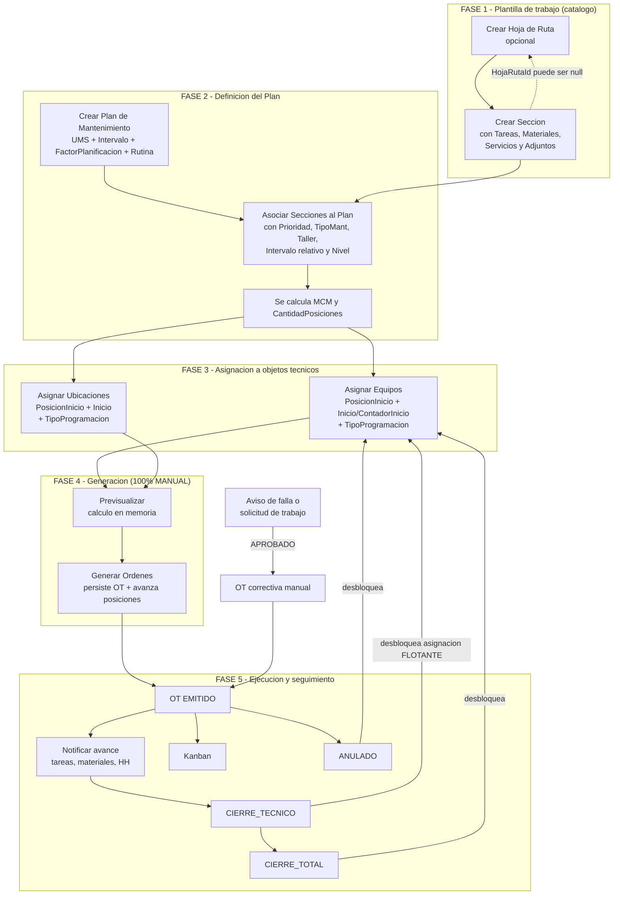
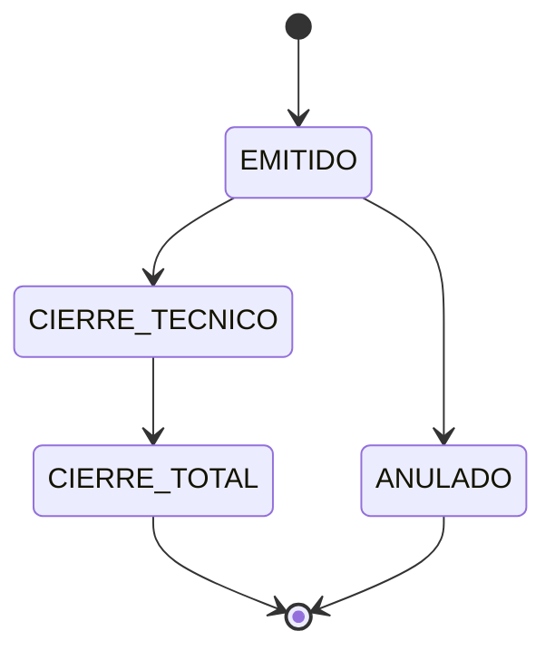
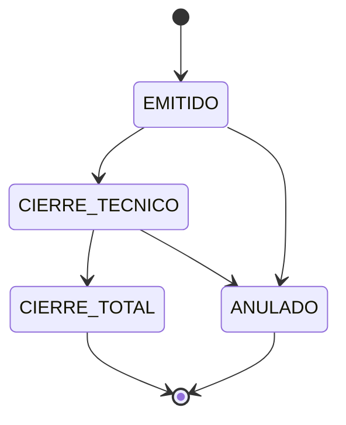
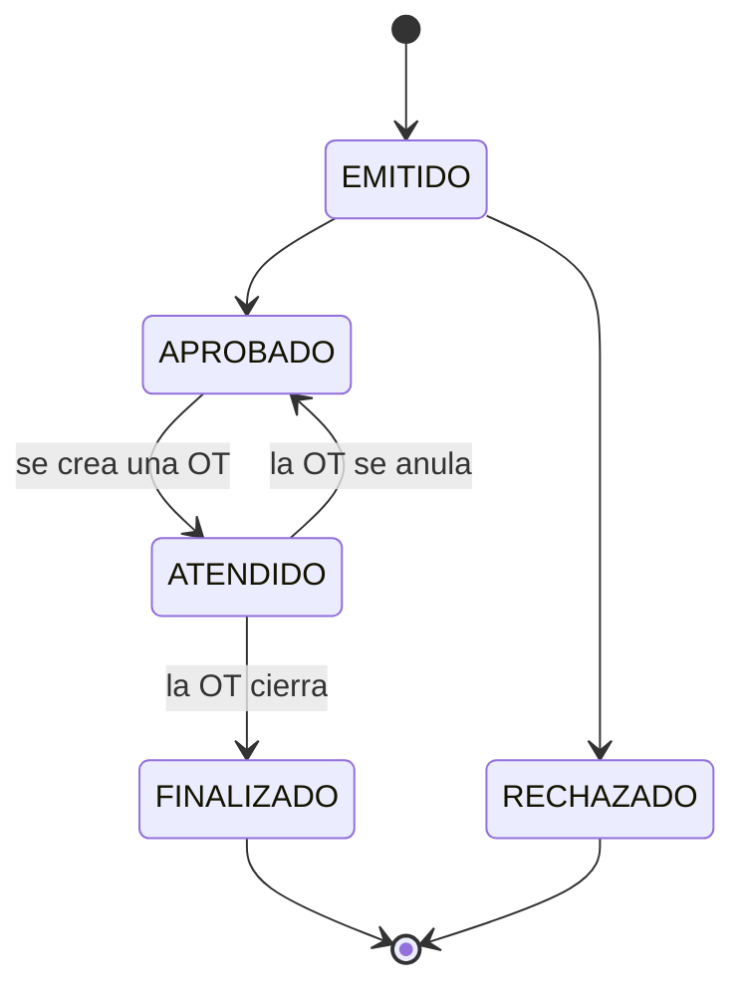
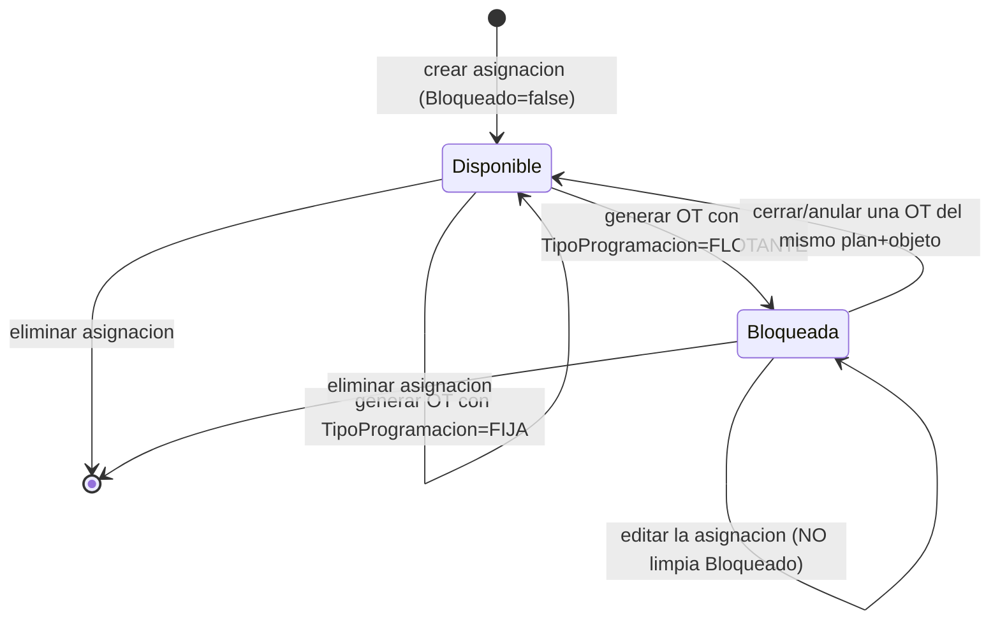

# Workflow Real – Módulo de Mantenimiento

> Reconstruido desde el código. Cada transición cita su evidencia.
> `HECHO` = verificado en código · `INFERENCIA` = deducido · `RECOMENDACIÓN` = propuesta.

---

## 1. Flujo funcional completo (descubierto, no asumido)



### Diferencias con el flujo asumido en el brief

| Flujo asumido | Flujo real |
|---------------|------------|
| `Crear Plan → Configurar Plan → Crear/asociar Hoja de Ruta` | La Hoja de Ruta y las Secciones se crean **antes e independientemente** del Plan. El Plan **selecciona** secciones ya existentes. |
| `Configurar Secciones → Configurar Tareas` como pasos del plan | Son pasos de un **catálogo separado** (`Gestión → Sección`), no del plan. |
| `Programación` como paso propio | No existe una pantalla de "programación". La programación es el par (`PosicionInicio`, `Inicio`/`ContadorInicio`) capturado en la pantalla *Asignar*. |
| `Generación/ejecución` automática | **Totalmente manual**: un humano pulsa *Generar*. |
| `Seguimiento → Finalización` | Existe (Notificar, Kanban, cierres) pero está en la entidad `OrdenTrabajo`, fuera del plan. |

---

## 2. Estados y transiciones: Orden de Trabajo

### 2.1 Máquina de estados declarada en el dominio

`AMSYS.Entidades/Gestion/Adicionales/OrdenTrabajo.Adicional.cs:12-23`



### 2.2 Máquina de estados declarada en el Kanban

`Areas/Gestion/Controllers/OrdenTrabajo.Controller.cs` → `KanbanMover`



> [!IMPORTANT]
> **RESUELTO POR DECISIÓN `D-02` (2026-08-29).**
> El propietario ha declarado: *"No debería permitirme anular una orden si esta se encuentra en
> cierre técnico."*
>
> La máquina de estados **válida es la del dominio** (§2.1). La tabla del Kanban (§2.2) es
> **incorrecta**: permite `CIERRE_TECNICO → ANULADO`, que el negocio prohíbe. Debe eliminarse y
> sustituirse por la definición del dominio.
>
> Sigue vigente el problema de que **ninguna de las dos se aplica** en `POST Editar` ni en
> `POST Notificar`. Ver `MNT-003`, ahora desbloqueada.

### 2.3 Tabla de transiciones detallada

| # | Origen | Destino | Quién puede | Condiciones aplicadas por el servidor | Efectos secundarios | Evidencia |
|---|--------|---------|-------------|----------------------------------------|---------------------|-----------|
| T1 | *(nuevo)* | `EMITIDO` | Generación por plan | Sección con contenido + equipo montado | Crea `OrdenTrabajoTarea`, `OrdenTrabajoMaterial`, `ProgramacionServicio`, `OrdenTrabajoLog(EMITIDO)`; avanza `PosicionActual`; bloquea si `FLOTANTE` | `PlanMantenimiento.Logica.cs` `GenerarOrdenes*` |
| T2 | *(nuevo)* | cualquiera | Usuario autenticado (sin permiso de acción) | `Estado` presente; si `< ANULADO` exige `InicioProgramado` | Crea **logs sintéticos** de 0 hasta el estado elegido; si viene de Aviso lo pasa a `ATENDIDO` | `OrdenTrabajo.Controller.Nuevo` + `OrdenTrabajo.Logica.GuardarAsync:136` |
| T3 | `EMITIDO` | `CIERRE_TECNICO` | Usuario autenticado | **ninguna** (no valida la transición) | Log de cambio; desbloquea la asignación del plan si `existeCierre == false`; si viene de Aviso lo pasa a `FINALIZADO` | `OrdenTrabajo.Logica.ActualizarAsync:247, 420` |
| T4 | `EMITIDO` | `ANULADO` | Usuario autenticado | ninguna | Desbloquea asignación; si viene de Aviso lo devuelve a `APROBADO` | ídem |
| T5 | `CIERRE_TECNICO` | `CIERRE_TOTAL` | Usuario autenticado | ninguna | Log; **no** vuelve a desbloquear (`existeCierre == true`) | ídem |
| T6 | `CIERRE_TECNICO` | `ANULADO` | Sólo vía Kanban | Tabla de `KanbanMover` | Igual que T4 | `KanbanMover` — **PROHIBIDA por `D-02`; debe eliminarse** |
| T7 | cualquiera | cualquiera | Usuario autenticado vía `POST Editar` | **ninguna** | Puede saltar `CIERRE_TOTAL → EMITIDO` o reabrir una anulada | `OrdenTrabajo.Logica.ActualizarAsync:247` |
| T8 | `EMITIDO`/`CIERRE_TECNICO` | mismo o superior | Usuario vía `Notificar` | ninguna | Registra notificaciones de tareas/materiales/empleados; recalcula `TotalTareasEjecutadas`; recalcula costos; ajusta `ContadorActual` del plan | `OrdenTrabajo.Logica.NotificarAsync` + `OrdenTrabajoCostoServicio.CalcularAsync` |

> [!CAUTION]
> **T7 es el hallazgo más grave del workflow**: `POST /Gestion/OrdenTrabajo/Editar` acepta
> cualquier valor de `Estado` sin validar el estado de origen. El `<select>` de la vista limita
> las opciones (`EstadosHabilitados()`), pero es una restricción **puramente visual**.

### 2.4 Guardas de "efecto único" (`existeCierre`)

Antes de aplicar efectos de cierre, las tres rutas (`ActualizarAsync`, `NotificarAsync`,
`ActualizarEstadoAsync`) consultan:

```csharp
bool existeCierre = ordenTrabajoLogRepositorio.CountBy(x =>
    x.OrdenTrabajoId == _.Id &&
    (x.Estado == CIERRE_TECNICO || x.Estado == CIERRE_TOTAL || x.Estado == ANULADO)) > 0;
```

Sirve para que el desbloqueo del plan ocurra **una sola vez** por orden.

> **PROBLEMA DETECTADO (MNT-011)**: la condición de `ActualizarAsync:225` contiene un error de
> variable — el tercer término es `_.Estado == ANULADO` (estado *actual de la OT*) en lugar de
> `x.Estado == ANULADO` (estado *del log*). Las otras dos rutas usan correctamente `x.Estado`.
> Consecuencia: si la OT ya está `ANULADO`, `existeCierre` da `true` para **cualquier** log,
> incluido el de `EMITIDO`, y el desbloqueo se omite indebidamente.

---

## 3. Estados y transiciones: Aviso

`AMSYS.Entidades/Gestion/Adicionales/Aviso.Adicional.cs`



| Transición | Disparador | Condición | Evidencia |
|------------|-----------|-----------|-----------|
| `EMITIDO → APROBADO/RECHAZADO` | `Aviso/Gestionar` | Manual | `Aviso.Controller.cs` |
| `APROBADO → ATENDIDO` | `POST OrdenTrabajo/Nuevo` con `AvisoId` | `_avisoServicio.PuedeAtender(...)` | `OrdenTrabajo.Controller.Nuevo` |
| `ATENDIDO → FINALIZADO` | `POST OrdenTrabajo/Editar` con estado de cierre | `_avisoServicio.PuedeFinalizar(...)` | `OrdenTrabajo.Controller.Editar` |
| `ATENDIDO → APROBADO` | `POST OrdenTrabajo/Editar` con `ANULADO` | ídem | ídem |

> [!WARNING]
> **PROBLEMA DETECTADO (MNT-007)**: la sincronización Aviso↔OT vive en el **controlador**
> `OrdenTrabajoController.Editar`, no en la lógica de negocio. Por tanto:
> - Cerrar la OT desde el **Kanban** (`KanbanMover` → `ActualizarEstadoAsync`) **no** finaliza el Aviso.
> - Cerrar la OT desde **Notificar** (`NotificarAsync`) **no** finaliza el Aviso.
> - Cerrar la OT desde la **API móvil** — verificar `Api/Controllers/OrdenTrabajoController.cs`.
>
> Resultado: avisos que quedan indefinidamente en `ATENDIDO` con su OT ya cerrada.

---

## 4. Estados del ciclo de programación (asignación Plan ↔ Objeto técnico)

No hay un enum de estado; el estado es la combinación de campos:



| Transición | Condición | Efectos | Evidencia |
|------------|-----------|---------|-----------|
| Crear | validaciones `BR-AS-004/005/006` | `PosicionActual = PosicionInicio`, `Registro = ahora` | `PlanMantenimientoEquipo.Logica.GuardarAsync` |
| Generar (FIJA) | condición de lanzamiento cumplida | avanza `PosicionActual` y `UltimaEjecucion` | `PlanMantenimiento.Logica.cs:217` |
| Generar (FLOTANTE) | ídem | además `Bloqueado = true` | ídem |
| Desbloquear | una OT de `(plan, objeto)` alcanza `CIERRE_TECNICO`/`CIERRE_TOTAL`/`ANULADO` y `existeCierre == false` | `Bloqueado = false`; `ContadorActual = PosicionActual * Intervalo` ajustado; `UltimaEjecucion = ahora` o `FechaEjecucion` | `OrdenTrabajo.Logica.cs:420, 693, 838` |
| Editar | validaciones de rango | **reinicia** posición/contador/última ejecución; `Bloqueado` **queda como estaba** | `PlanMantenimientoEquipo.Logica.ActualizarAsync` |

> [!CAUTION]
> **PROBLEMA CRÍTICO DETECTADO (MNT-005)**: no existe **ninguna** ruta de UI que ponga
> `Bloqueado = false` sin pasar por el cierre de una OT concreta.
> `PlanMantenimiento/Ver.cshtml` sólo **muestra** el estado (`SI`/`NO` en rojo).
> Escenarios que dejan una asignación muerta para siempre:
> - La OT que la bloqueó se borra de base de datos.
> - `existeCierre` ya era `true` cuando se cerró (por T2: crear la OT directamente en un estado de
>   cierre siembra el log de cierre, de modo que el desbloqueo posterior nunca se ejecuta).
> - El bug de variable descrito en §2.4 (`_.Estado` en lugar de `x.Estado`).

---

## 5. Flujos alternativos y excepcionales

### 5.1 Flujo alternativo — OT correctiva desde Aviso
`Aviso EMITIDO → APROBADO → GET /Gestion/OrdenTrabajo/NuevoPorAviso/{id} → POST Nuevo → Aviso ATENDIDO`.
La OT copia ubicación, equipo, sistema y parte del aviso.

### 5.2 Flujo alternativo — Sub-orden
`GET /Gestion/OrdenTrabajo/NuevoPorOrdenTrabajo/{id}` crea una OT con `OrdenTrabajoPadreId`.
**HECHO**: no hay ninguna regla que sincronice estados entre padre e hija. Se puede cerrar la
padre con hijas abiertas.

### 5.3 Flujo alternativo — OT manual por Equipo o por Ubicación
`NuevoPorEquipo` / `NuevoPorUbicacion`. Sin plan ni aviso asociado.

### 5.4 Flujo excepcional — generación selectiva
`POST /Gestion/OrdenTrabajo/Previsualizar` con un array `entidades[]`.
La selección se lee del DOM con `$('input[name="Rutina"]:checked:visible')`.
> **PROBLEMA DETECTADO (MNT-032)**: si el usuario está en la pestaña *Tarjetas*, los checkboxes de
> la tabla no son `:visible` → se envía una selección vacía y el sistema informa
> *"Se generaron 0 orden(es) de trabajo"* sin explicar por qué. Además el `$.post` **no tiene
> manejador `error`**: cualquier fallo del servidor deja el botón deshabilitado y sin mensaje.

### 5.5 Flujo excepcional — equipo sin ubicación
Si un equipo (y toda su cadena de padres) carece de `UbicacionId`, la generación hace `continue`
sin registrar nada. `INFERENCIA`: el planificador no tiene forma de enterarse.

### 5.6 Flujo excepcional — plan atrasado varios ciclos
Ver `BR-GE-005` / `BR-GE-006`: por CALENDARIO hay que pulsar *Generar* tantas veces como ciclos de
atraso; por CONTADOR el sistema salta al ciclo final y **pierde** los intermedios.

> [!IMPORTANT]
> **Reinterpretado tras la decisión `D-05` (2026-08-29).**
> El propietario ha confirmado que la generación es **a demanda, precisamente para controlar el
> backlog**. Con ese criterio:
> - El comportamiento por **CALENDARIO** (una posición por pulsación) es **correcto**: conserva el
>   trabajo pendiente y deja que el planificador lo libere a su ritmo.
> - El comportamiento por **CONTADOR** (saltar al ciclo final descartando los intermedios) es
>   **incoherente** con esa decisión: pierde mantenimiento en silencio en lugar de dejarlo pendiente.
>
> Nueva decisión pendiente `D-05b` y tarea `MNT-008b`.

---

## 6. Acciones disponibles según estado de la OT

| Acción | EMITIDO | CIERRE_TECNICO | CIERRE_TOTAL | ANULADO | Aplicada en |
|--------|:-------:|:--------------:|:------------:|:-------:|-------------|
| Editar cabecera | ✅ | ✅ | ❌ | ❌ | sólo vista (`PuedoEditar`) |
| Cambiar equipo/ubicación | ✅ | ❌ | ❌ | ❌ | sólo vista (`PuedoModificarObjetoTecnico`) |
| Notificar avance | ✅* | ✅* | ❌ | ❌ | sólo vista (`PuedoNotificar`, requiere `PuedeEjecutar`) |
| Notificar parámetros | ✅ | ✅ | ❌ | ❌ | sólo vista |
| Mover en Kanban | ✅ | ✅ | ❌ | ❌ | **servidor** (`KanbanMover`) |
| Generar PDF | ✅ | ✅ | ✅ | ✅ | — |

`*` requiere además `OrdenTrabajo.PuedeEjecutar == true`.

> **HECHO**: la única acción cuyo estado se valida en el **servidor** es `KanbanMover`.
> Todas las demás dependen de que el navegador respete el render.

---

## 7. Roles involucrados por fase

`INFERENCIA` — el sistema no nombra roles; se deducen del modelo de páginas (`Pagina`/`RolPagina`)
y de las pantallas existentes.

| Fase | Rol funcional | Páginas necesarias |
|------|---------------|--------------------|
| Plantilla | Planificador | `Gestion/HojaRuta/*`, `Gestion/Seccion/*` |
| Plan | Planificador | `Gestion/PlanMantenimiento/*` |
| Asignación | Planificador | `Gestion/PlanMantenimiento/Asignar` (+ los controladores de asignación, que **no exigen permiso**) |
| Generación | Supervisor / Planificador | `Gestion/OrdenTrabajo/Previsualizar` |
| Ejecución | Técnico | `Gestion/OrdenTrabajo/Notificar`, API móvil |
| Seguimiento | Supervisor | `Gestion/OrdenTrabajo/{Index,Kanban,Ver}` |
| Cierre | Supervisor | `Gestion/OrdenTrabajo/Editar` |
| Análisis | Analista | `Reporte/*` |

Ver `analysis/permissions.md` para el detalle de qué está realmente protegido.

---

## 8. Resumen de problemas del workflow

| ID | Sev. | Categoría | Resumen |
|----|------|-----------|---------|
| MNT-003 | HIGH | BUSINESS_RULE | Dos máquinas de estados divergentes; ninguna se aplica en `Editar`/`Notificar`. **Desbloqueada por `D-02`**: se adopta la del dominio y se corrige el Kanban |
| MNT-005 | CRITICAL | BUSINESS_RULE | Asignación FLOTANTE bloqueada sin ruta de desbloqueo |
| MNT-007 | HIGH | BUSINESS_RULE | La sincronización Aviso↔OT sólo existe en `OrdenTrabajoController.Editar` |
| MNT-008 | MEDIUM | BUSINESS_RULE | ~~No hay generación automática~~ → **`D-05`: la generación manual es deliberada.** Queda documentar la decisión y dar observabilidad |
| MNT-008b | HIGH | BUSINESS_RULE | Los planes por CONTADOR descartan las posiciones intermedias, en contra del criterio de `D-05` |
| MNT-011 | HIGH | DATA_INTEGRITY | Logs sintéticos + bug de variable en `existeCierre` |
| MNT-032 | MEDIUM | UX | Generación selectiva silenciosa y `$.post` sin manejo de error |
| MNT-033 | MEDIUM | BUSINESS_RULE | Sub-órdenes sin ninguna regla de sincronización con la OT padre |
